# Звіт з лабораторної роботи №2
Виконав: Ліпкін Артем 

---

## 1. Мета роботи

1. Знайомство з інтерфейсами ОС Linux.
2. Отримання практичних навичок роботи в середовищах ОС Linux та мобільної ОС: робота з графічною оболонкою, вхід і вихід із системи, структура робочого столу, основні дії та налаштування.

---

## 2. Завдання попередньої підготовки

### 2.1. Словник базових англійських термінів з питань призначення команд та їх параметрів (*)

| Термін (англ.) | Переклад | Пояснення |
|---|---|---|
| Command line interface (CLI) | Інтерфейс командного рядка | Текстовий спосіб керування ОС введенням команд |
| Command | Команда | Інструкція для оболонки: ім'я програми або вбудованої функції (`ls`, `cd`) |
| Shell | Командна оболонка | Програма, що читає команди та запускає їх (bash, zsh) |
| Prompt | Запрошення | Рядок перед курсором, напр. `user@host:~$` (`#` — для root) |
| Terminal / Terminal emulator | Термінал / емулятор термінала | Вікно в GUI, що імітує текстовий термінал (GNOME Terminal) |
| Console | Консоль | Текстовий термінал системи |
| Argument | Аргумент | Дані, з якими працює команда: файл, каталог, рядок (`ls /etc`) |
| Option (switch, flag) | Опція (ключ, прапорець) | Змінює поведінку команди (`ls -l`) |
| Syntax | Синтаксис | Загальний вигляд: `команда [опції] [аргументи]` |
| Built-in command | Вбудована команда | Реалізована в самій оболонці (`cd`, `echo`, `type`) |
| External command | Зовнішня команда | Окремий виконуваний файл (`/usr/bin/ls`) |
| Path / Absolute / Relative path | Шлях / абсолютний / відносний | Розташування файлу: `/home/user/doc` або `../doc` |
| Working directory | Робочий (поточний) каталог | Каталог, у якому перебуває користувач (`pwd`) |
| Home directory | Домашній каталог | Особистий каталог користувача (`~`, `/home/user`) |
| History | Історія команд | Список раніше виконаних команд (`history`, `↑`, `!!`) |
| Exit status (return code) | Код завершення | Число 0 (успіх) або інше (помилка), `$?` |
| Process | Процес | Запущена програма, що має PID |
| Superuser (root) | Суперкористувач | Адміністратор з необмеженими правами |
| sudo / su | Виконання від імені іншого користувача | `sudo` — одна команда від імені root, `su` — зміна користувача |
| Script | Скрипт (сценарій) | Текстовий файл з послідовністю команд оболонки |
| Package manager | Менеджер пакетів | Встановлення та оновлення ПЗ (`apt`, `dnf`) |

### 2.2. Визначення понять (**)

**CLI-режим (Command Line Interface)** — текстовий режим взаємодії користувача з ОС. Користувач вводить команди з клавіатури у визначеному синтаксисі (`команда [опції] [аргументи]`), командна оболонка (shell, напр. bash) інтерпретує їх і виводить результат у текстовому вигляді. CLI потребує мінімум ресурсів і дає точне керування системою.

**Термінал на основі графічного інтерфейсу користувача (GUI terminal, terminal emulator)** — програма, що працює всередині графічного середовища та **емулює вікно текстового термінала**. Усередині неї запускається командна оболонка. Приклади: GNOME Terminal / Console (GNOME), Konsole (KDE), xfce4-terminal, xterm. Відкривається через меню застосунків, пошук або `Ctrl+Alt+T`. Таких вікон і вкладок може бути одночасно багато.

**Віртуальний термінал (virtual terminal, virtual console, VT)** — повноекранна текстова консоль, яку ядро Linux надає безпосередньо на фізичному моніторі й клавіатурі. Він працює **одночасно з GUI**, але не залежить від нього: доступний навіть тоді, коли графічна оболонка «зависла» або не встановлена. Перед виконанням команд потрібно увійти в систему (ввести логін і пароль). 
---

## 3. Хід роботи (основні позиції)

### 3.1. Робота в графічному режимі ОС Linux (графічна оболонка GNOME)

#### 1.1. Структура робочого простору користувача GNOME

Для роботи обрано **GNOME** (Ubuntu 24.04 LTS, GNOME 46).

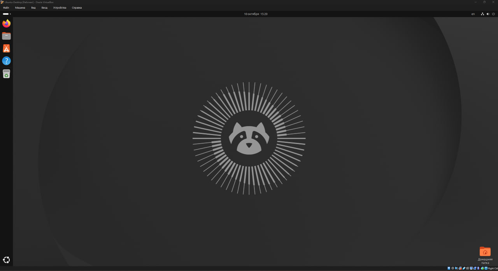

*Рис. 1. Робочий стіл GNOME після входу в систему: верхня панель, Ubuntu Dock ліворуч*

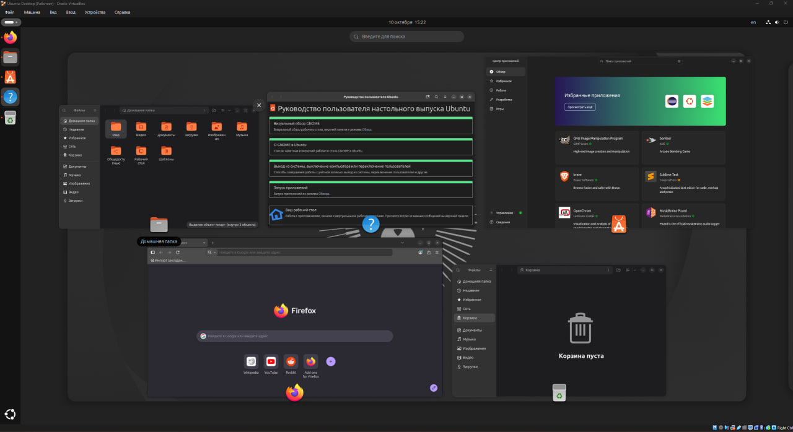

*Рис. 2. Режим «Огляд» (Activities): рядок пошуку, мініатюри відкритих вікон, док*

Основні компоненти робочого простору:

- **Верхня панель (Top bar).** Розташована вгорі екрана. Зліва — кнопка **«Огляд» (Activities)**, у центрі — **годинник і календар** з центром сповіщень, справа — **системне меню**: мережа, звук, Bluetooth, яскравість, живлення, режими живлення, швидкі перемикачі, кнопка вимкнення.
- **Основне меню — сітка застосунків (App Grid).** Викликається кнопкою «Показати застосунки» (9 крапок) у доку або клавішею `Super` двічі (`Super+A`). Показує всі встановлені програми, які можна групувати в теки перетягуванням.
- **Панель швидкого доступу — Dash / Ubuntu Dock.** У ванільному GNOME Dash видно в режимі «Огляд» внизу екрана. В Ubuntu це постійна панель зліва. Містить **улюблені** програми (закріплені), **запущені** програми (з індикатором-крапкою), кошик та підключені диски. Додати програму: ПКМ → «Додати до обраного» (Pin to Dash).
- **Пошук.** У режимі «Огляд» (клавіша `Super`) достатньо почати вводити текст. Пошук охоплює застосунки, налаштування, файли (Files), калькулятор, календар, термінал тощо. Джерела пошуку налаштовуються в *Параметри → Пошук*.
- **Робочі столи (Workspaces).** GNOME використовує **динамічні** робочі столи: новий порожній стіл з'являється автоматично. У режимі «Огляд» вони показані мініатюрами вгорі, їх можна вибрати або перетягнути вікно на інший стіл. Клавіші: `Super+PageUp/PageDown` або `Ctrl+Alt+←/→` — перемикання; `Super+Shift+PageUp/PageDown` — перенести вікно. Жест тачпада — три пальці вліво/вправо.
- **Вікна застосунків.** Заголовок із кнопками (згорнути, розгорнути, закрити), прилипання до половини екрана (`Super+←/→`), перемикання `Alt+Tab`.
- **Центр сповіщень і календар** — клік на годинник.
- **Параметри (Settings)** — налаштування мережі, вигляду, дисплея, користувачів, живлення, клавіатури, конфіденційності.
- **Файловий менеджер Files (Nautilus)** — домашній каталог, бічна панель з закладками, підключеними пристроями та кошиком.

> **Примітка.** В інших оболонках (KDE Plasma, Xfce, Cinnamon) замість режиму «Огляд» використовується класичне меню «Пуск» і панель завдань.

#### 1.2. Запуск програм (*)

| Спосіб | Як виконати | Скріншот |
|---|---|---|
| **Через панель швидкого запуску (Dash / Ubuntu Dock)** | Клацнути значок програми в доку (напр. Firefox або Files). Повторний клік на запущеній програмі — перейти до її вікна; середня кнопка миші або `Ctrl`+клік — нове вікно. Клавіші `Super+1…9` запускають програму з відповідного місця в доку | Рис. 1 (док ліворуч) |
| **Через пошук у меню / глобальне меню** | Натиснути `Super` (або «Огляд»), ввести назву, напр. `term` або `calc`, натиснути `Enter`. Або відкрити сітку застосунків (`Super+A`) та клацнути потрібний значок | Рис. 3, 4 |
| **Через віджет запуску (діалог «Виконати команду»)** | Натиснути `Alt+F2`, ввести ім'я команди (`gnome-calculator`, `gedit`, `firefox`), натиснути `Enter` | Рис. 5, 6 |
| **Через термінал** (додатково) | `Ctrl+Alt+T` → ввести, напр., `gnome-text-editor &` (символ `&` — запуск у фоні) | — |
| **Через ярлик на робочому столі** (додатково) | Подвійний клік по `.desktop`-файлу в `~/Desktop` (в Ubuntu — розширення Desktop Icons NG) | — |

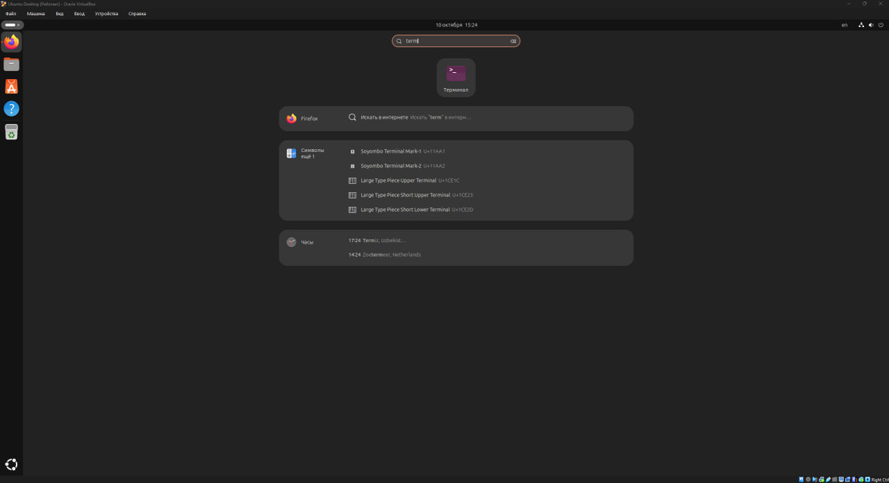

*Рис. 3. Запуск програми через пошук у режимі «Огляд» (запит «term» → Термінал)*

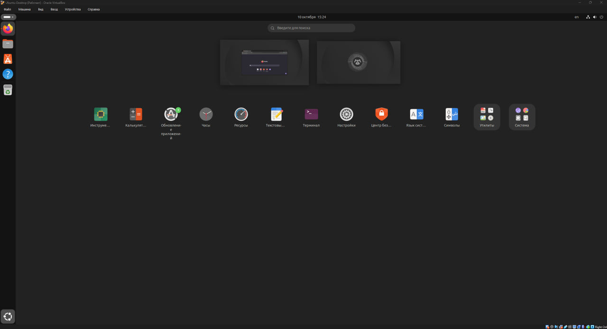

*Рис. 4. Сітка застосунків (App Grid), над нею — мініатюри робочих столів*

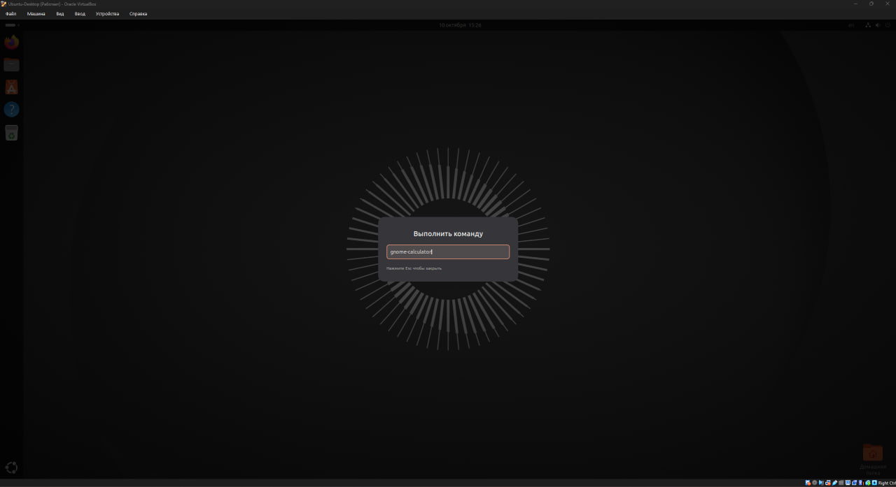

*Рис. 5. Діалог `Alt+F2` «Выполнить команду» з командою `gnome-calculator`*

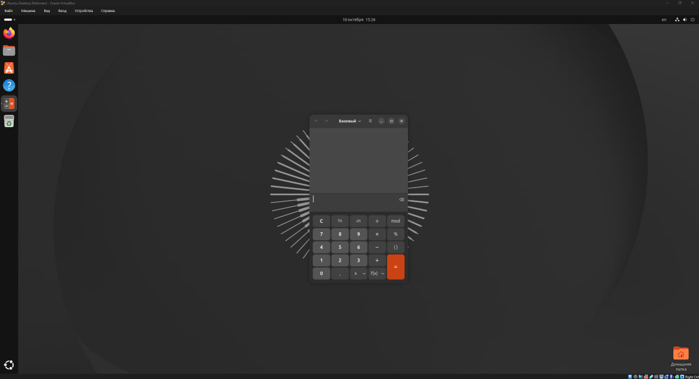

*Рис. 6. Калькулятор, запущений через діалог `Alt+F2`*

#### 1.3. Вихід із системи та завершення роботи в Linux (*)

Усі дії виконуються через **системне меню** у правому верхньому куті (значки мережі/звуку/живлення) → кнопка **живлення (⏻)**.

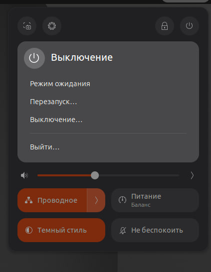

*Рис. 7. Системне меню з розгорнутим підменю «Выключение»: «Режим ожидания», «Перезапуск…», «Выключение…», «Выйти…»*

**Зміна користувача на root**

- **У графічному режимі** можна змінити користувача: системне меню → ⏻ → **«Змінити користувача» (Switch User)** або **«Вийти» (Log Out)**, після чого на екрані входу GDM обрати іншого користувача. Пункт «Змінити користувача» з'являється, коли в системі більше одного облікового запису.
- **Вхід у графічну сесію як root у GNOME за замовчуванням заборонено** (GDM не показує root, а в Ubuntu обліковий запис root навіть не має пароля) з міркувань безпеки.
- Тому права root в GUI отримують через термінал (`Ctrl+Alt+T`):

```bash
sudo -i
whoami
exit
```

- Графічні програми, що потребують прав адміністратора (Параметри → Користувачі, Software, Disks), запитують пароль через вікно **polkit** («Потрібна автентифікація»).

Оскільки в системі один обліковий запис, пункт «Змінити користувача» в меню відсутній (рис. 7). Перехід на root виконано через термінал:

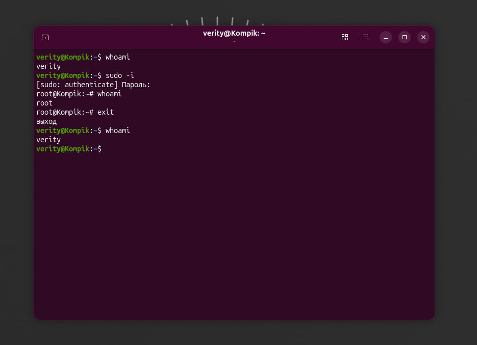

*Рис. 8. Зміна користувача на root: `whoami` → `verity`, `sudo -i` → запрошення `root@Kompik:~#`, `whoami` → `root`, `exit` → повернення до `verity`*

**Перезавантаження системи**

- GUI: системне меню → ⏻ → **«Перезапустити…» (Restart)** → підтвердити (через 60 с перезавантаження відбувається автоматично).
- Термінал: `sudo reboot` або `systemctl reboot`.

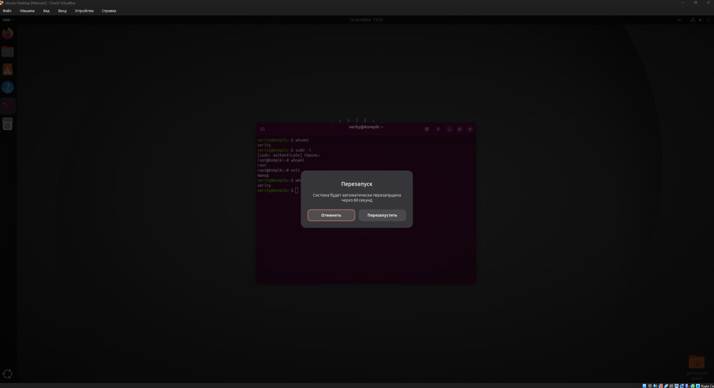

*Рис. 9. Діалог «Перезапуск»: система буде автоматично перезапущена через 60 секунд*

**Вимкнення системи**

- GUI: системне меню → ⏻ → **«Вимкнути…» (Power Off)** → підтвердити. Також можна натиснути фізичну кнопку живлення (дія налаштовується в *Параметри → Живлення*).
- Термінал: `sudo poweroff`, `systemctl poweroff`, `sudo shutdown -h now`, `sudo shutdown -h +10` (через 10 хв).

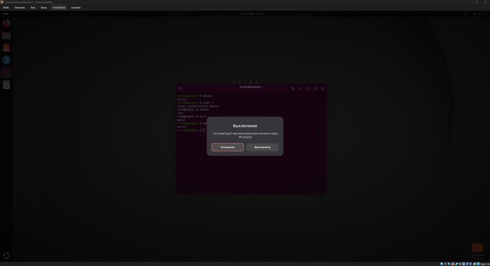

*Рис. 10. Діалог «Выключение»: система буде автоматично вимкнена через 60 секунд*

Інші дії меню: **«Призупинити» (Suspend)** — сон; **«Вийти» (Log Out)** — завершення сеансу без вимкнення комп'ютера; **«Заблокувати» (Lock, `Super+L`)** — блокування екрана.

### 3.2. Робота в середовищі мобільної ОС (**)

Для дослідження використано смартфон **Samsung Galaxy S25 Ultra** під керуванням **Android 17** з фірмовою оболонкою **Samsung One UI 9**.

#### 2.1. Головне меню мобільної ОС та її графічний інтерфейс

Android використовує **сенсорний графічний інтерфейс** на основі принципів **Material Design**. Samsung встановлює поверх нього власну оболонку **One UI**. Вона розрахована на роботу однією рукою: заголовки та інформація розміщені у верхній частині екрана, а елементи керування — у нижній, у зоні досяжності великого пальця. Головний екран формує лаунчер **One UI Home**. Відображення графіки забезпечує системний компонент SurfaceFlinger.

Структура інтерфейсу:
- **Рядок стану (Status bar)** — вгорі: час, значки сповіщень, мобільна мережа, Wi-Fi, рівень заряду.
- **Панель сповіщень і панель швидких налаштувань.** В One UI 7 і новіших вони за замовчуванням розділені:
  - свайп униз від **лівої** частини верхнього краю — **сповіщення**;
  - свайп униз від **правої** частини — **швидкі налаштування**: Wi-Fi, Bluetooth, ліхтарик, режим польоту, «Не турбувати», енергозбереження, автоповорот, Quick Share, повзунок яскравості, кнопки ⏻ (живлення) та ⚙ (налаштування).

  Спосіб відкриття змінюється в самій панелі (олівець → «Налаштування панелі»).
- **Головний екран (Home screen)** — кілька сторінок з ярликами, папками та **віджетами** (погода, годинник, календар, віджети-стопки).
- **Док (Favorites)** — нижній ряд закріплених програм, однаковий на всіх сторінках.
- **Меню програм (App drawer)** — свайп угору з головного екрана: усі встановлені програми, рядок пошуку **Finder**, папки, сортування за алфавітом.
- **Навігація:** жести (свайп знизу — додому; свайп знизу з утриманням — нещодавні програми; свайп від бокового краю — назад) або кнопки «Нещодавні», «Додому», «Назад». Налаштовується в «Налаштування → Дисплей → Панель навігації».
- **Нещодавні програми (Recents)** — перемикання між програмами, закриття, розділення екрана, спливаючі вікна.
- **Бічна панель (Edge panel)** — вузький язичок на краю екрана для швидкого запуску улюблених програм.
- **Екран блокування та Always On Display (AOD)** — час, сповіщення, а в One UI 7 і новіших — **Now Bar** (поточні дії: таймер, музика, навігація).
- **Galaxy AI та Google:** «Обвести для пошуку» (Circle to Search) — утримання жесту/кнопки «Додому»; асистент Gemini — утримання бічної клавіші.
- **S Pen** (особливість моделі Ultra) — меню Air Command для записів на екрані, скріншотів із приміткою та виділення тексту.

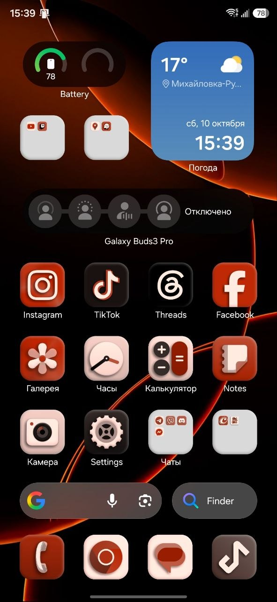

*Рис. 11. Головний екран One UI з віджетами, рядком пошуку та доком*

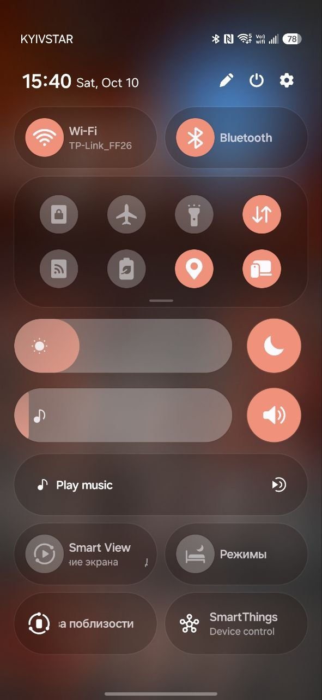

*Рис. 12. Панель швидких налаштувань*

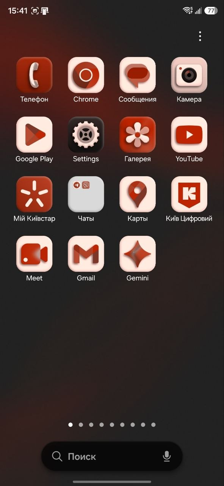

*Рис. 13. Меню програм (App drawer)*

#### 2.2. Меню налаштувань компонентів мобільного телефону

Відкривається значком ⚙ у панелі швидких налаштувань або через програму **«Налаштування»**. Угорі розташовані **рядок пошуку** та **обліковий запис Samsung**. Основні розділи:

| Розділ One UI | Що налаштовується |
|---|---|
| Підключення | Wi-Fi, Bluetooth, NFC і безконтактні платежі, режим польоту, SIM-картки, мобільні мережі, використання даних, мобільна точка доступу, VPN, приватний DNS |
| Під'єднані пристрої | Quick Share, Android Auto, Samsung DeX, Smart View, друк, Galaxy Wearable |
| Режими та процедури | Режими «Сон», «Тренування», «Водіння», «Робота»; автоматизація дій за умовами (Routines) |
| Звуки та вібрація | Режим звуку, мелодії, гучність, вібрація, Dolby Atmos |
| Сповіщення | Сповіщення програм, стиль спливаючих сповіщень, «Не турбувати» |
| Дисплей | Яскравість, темний режим, плавність руху (адаптивна частота до 120 Гц), Eye comfort shield, роздільна здатність, розмір шрифту, тайм-аут екрана, панель навігації, Edge panels |
| **Акумулятор** | Рівень заряду, статистика використання, енергозбереження, обмеження фонової роботи, захист акумулятора, параметри заряджання |
| Шпалери та стиль / Теми | Шпалери, кольорова палітра, теми, значки |
| Головний екран | Сітка значків, папки, жести, бейджі сповіщень |
| Екран блокування та AOD | Тип блокування, Always On Display, годинник, Now Bar |
| Безпека та конфіденційність | Біометрія (ультразвуковий сканер відбитка під екраном, розпізнавання обличчя), **Захищена папка**, Samsung Pass, «Знайти мій телефон» (SmartThings Find), дозволи програм, Auto Blocker, оновлення безпеки |
| Розташування | GPS, точність геолокації, доступ програм до місцезнаходження |
| Безпека та надзвичайні ситуації | Екстрені контакти, екстрене SOS, медична інформація |
| Облікові записи та архівація | Облікові записи Samsung і Google, Samsung Cloud, Smart Switch |
| Google | Сервіси Google, налаштування акаунта |
| Додаткові функції | **Бічна клавіша**, Galaxy AI, S Pen, рух і жести, режим роботи однією рукою, знімки екрана |
| Цифрове благополуччя | Екранний час, ліміти програм, батьківський контроль |
| Обслуговування пристрою | Оптимізація, пам'ять, ОЗП, захист від шкідливого ПЗ, діагностика |
| Програми | Список програм, програми за замовчуванням, дозволи, примусова зупинка |
| Загальне керування | Мова, клавіатура Samsung, дата і час, **скидання** |
| Спеціальні можливості | TalkBack, збільшення, контраст, слухові налаштування |
| Оновлення ПЗ | Перевірка та встановлення оновлень One UI/Android |
| Відомості про телефон | Модель, номер, IMEI, версія Android та One UI (7 натискань на «Номер збірки» → «Параметри розробника») |

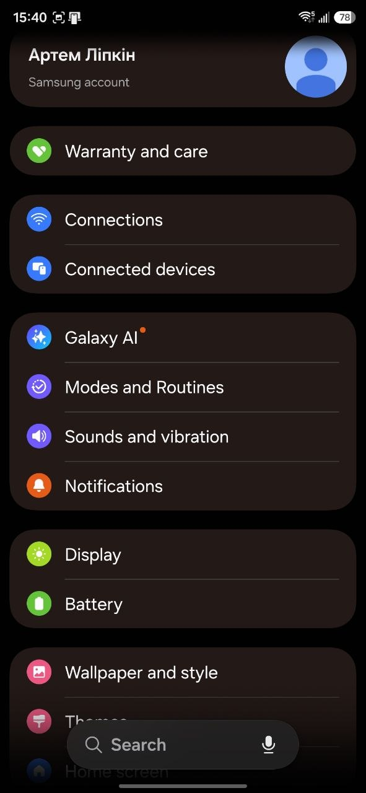

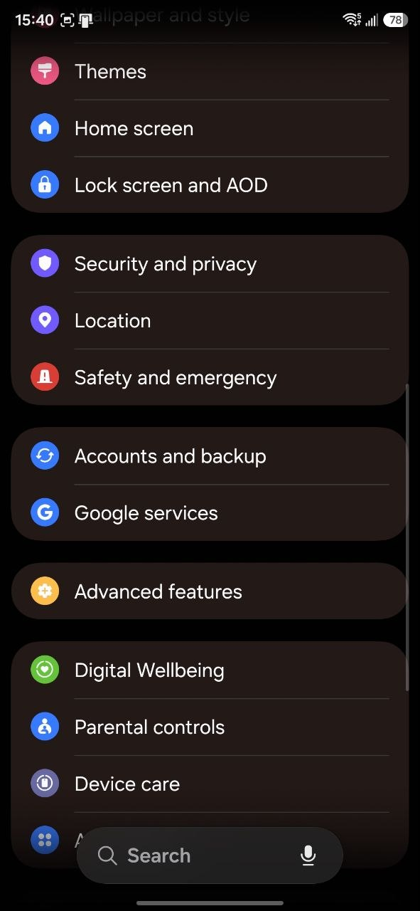

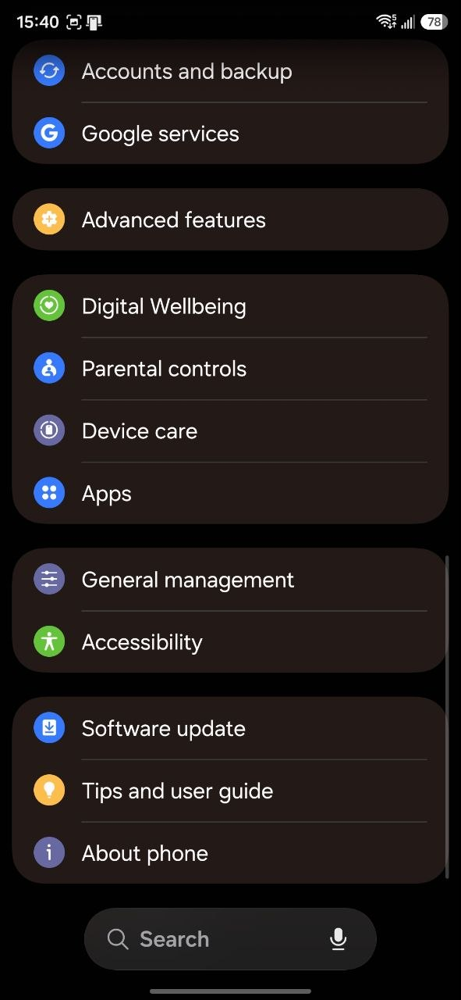

*Рис. 14. Головне меню «Налаштування» One UI (обліковий запис Samsung, Connections, Display, Battery, Security and privacy, Advanced features, Device care, About phone та ін.)*

#### 2.3. Використання комбінацій клавіш для виконання спеціальних дій

Апаратні клавіші S25 Ultra: **бічна клавіша** (живлення) та **гучність вгору/вниз** праворуч. Дії бічної клавіші налаштовуються в «Налаштування → Додаткові функції → Бічна клавіша».

| Комбінація | Дія |
|---|---|
| Коротке натискання бічної клавіші | Увімкнути / заблокувати екран |
| Утримання бічної клавіші | За замовчуванням — виклик асистента **Gemini** (можна змінити на «Меню вимкнення») |
| **Бічна клавіша + гучність вниз (утримання ~2 с)** | **Меню вимкнення**: «Вимкнути» / «Перезапустити» / «Екстрений виклик» |
| **Бічна клавіша + гучність вниз (коротко)** | **Знімок екрана** |
| Подвійне натискання бічної клавіші | Швидкий запуск **камери** (налаштовується) |
| Багаторазове (3–5) натискання бічної клавіші | **Екстрене SOS** (якщо увімкнено в «Безпека та надзвичайні ситуації») |
| Утримання бічної клавіші + гучність вниз **понад 7 с** | **Примусове перезавантаження** зависаючого телефону |
| Утримання пункту «Вимкнути» в меню вимкнення | **Безпечний режим** (Safe mode) — без сторонніх програм |
| Бічна клавіша + гучність вгору на вимкненому телефоні, підключеному кабелем до ПК | Меню **Recovery** (скидання, очищення кешу) |
| Гучність вгору + гучність вниз при підключенні кабелю до ПК | **Download mode** (режим прошивки Odin) |
| Гучність вгору + бічна клавіша (одночасно) | Ярлик спеціальних можливостей (налаштовується) |
| Клавіша гучності в «Камері» | Затвор або зум |
| Жест долонею по екрану (вмикається в «Додаткові функції → Рухи та жести») | Знімок екрана |
| Кнопка S Pen + подвійне натискання / Air Command | Нотатка на вимкненому екрані, знімок екрана з приміткою |

#### 2.4. Вхід у систему та завершення роботи пристрою. Особливості налаштувань живлення батареї

**Вхід у систему:**
- **Увімкнення:** утримувати бічну клавішу ~3 с до появи логотипу Samsung. Після завантаження вводиться **PIN-код SIM-карти** (якщо встановлено), а потім пристрій розблоковується.
- **Розблокування:** проведення по екрану, PIN-код, пароль, графічний ключ або біометрія: ультразвуковий **сканер відбитка під екраном** чи **розпізнавання обличчя**. Після перезавантаження завжди потрібен PIN або пароль, бо ним розшифровуються дані користувача; біометрія працює лише після першого розблокування.
- **Захищена папка (Secure Folder):** окремий зашифрований простір із власним паролем для програм і файлів. На смартфонах Samsung вона замінює режим кількох користувачів.
- **Обліковий запис Samsung / Google:** синхронізація, резервні копії, «Знайти мій телефон».

**Завершення роботи:**
- **Блокування екрана:** коротке натискання бічної клавіші.
- **Вимкнення / перезапуск:**
  1. **бічна клавіша + гучність вниз** (утримання) → «Вимкнути» / «Перезапустити»;
  2. або значок **⏻** у панелі швидких налаштувань;
  3. або утримання бічної клавіші, якщо в налаштуваннях для неї обрано «Меню вимкнення».
- **Автоматичний перезапуск** за розкладом: «Обслуговування пристрою → Автооптимізація» — для підтримки швидкодії.

**Налаштування живлення батареї** (*Налаштування → Акумулятор*). Акумулятор S25 Ultra має ємність 5000 мА·год; підтримується дротова зарядка 45 Вт, бездротова 15 Вт і зворотна бездротова **Wireless PowerShare** 4,5 Вт.
- **Використання акумулятора** — статистика за програмами, графік заряду, прогноз часу роботи.
- **Енергозбереження** — обмежує фонові процеси, частоту оновлення екрана до 60 Гц, яскравість, 5G, синхронізацію, Always On Display. Можна налаштувати, що саме обмежувати, та автоматичне ввімкнення на заданому рівні заряду.
- **Обмеження фонового використання:**
  - «Сплячі програми» — обмежена фонова робота;
  - «Програми в глибокому сні» — працюють лише під час відкриття;
  - «Ніколи не присипляти» — програми без обмежень (месенджери, будильники).

  Тут же — «Присипляти невикористовувані програми» та **адаптивне енергозбереження**, що вмикається залежно від звичок користувача.
- **Захист акумулятора** — продовжує ресурс батареї:
  - «Базовий» — заряджає до 100 %, зупиняє й продовжує за 95 %;
  - «Адаптивний» — тримає 80 % під час сну і дозаряджає до пробудження;
  - «Максимальний» — обмежує заряд на рівні **80 %**.
- **Параметри заряджання** — увімкнення/вимкнення швидкої, надшвидкої (45 Вт) та бездротової швидкої зарядки.
- **Відсоток заряду** в рядку стану.
- **Профіль продуктивності** («Обслуговування пристрою»): «Стандартний» / «Полегшений» — менше нагрівання та витрати енергії.
- **Автозатемнення екрана** при рівні заряду нижче 5 %.
- Додаткові способи економії: темний режим (AMOLED-екран не витрачає енергію на чорні пікселі), адаптивна частота оновлення, менший тайм-аут екрана, вимкнення AOD, а також Wi-Fi, Bluetooth, NFC і геолокації, коли вони не потрібні.

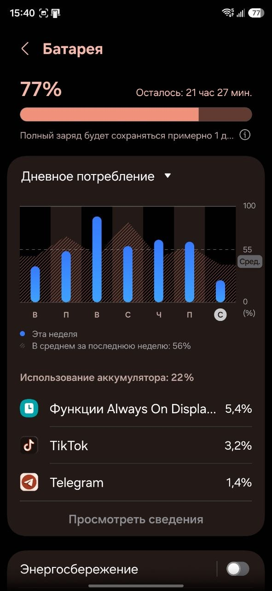

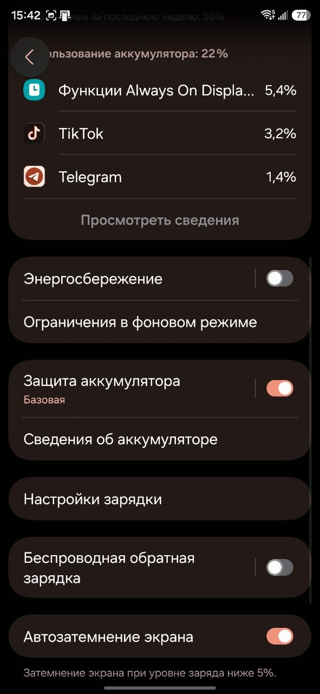

*Рис. 15. Екран «Батарея»: рівень заряду та прогноз роботи, графік денного споживання, використання за програмами (вгорі); енергозбереження, обмеження у фоновому режимі, захист акумулятора («Базовая»), налаштування зарядки, бездротова зворотна зарядка, автозатемнення екрана (внизу)*

---

## 4. Відповіді на контрольні запитання

**1. Приклади серверних додатків Linux для серверів баз даних, розсилки повідомлень та файлообмінників.**

| Категорія | Приклади |
|---|---|
| Сервери баз даних | MySQL, MariaDB, PostgreSQL, SQLite (вбудована), MongoDB, Redis, Cassandra, Oracle Database, Microsoft SQL Server for Linux |
| Поштові сервери (розсилка повідомлень) | MTA: Postfix, Sendmai*, Exim; IMAP/POP3: Dovecot, Cyrus; комплексні: Zimbra, iRedMail, Mailcow; антиспам: SpamAssassin, rspamd; списки розсилки: GNU Mailman |
| Сервери обміну повідомленнями | Ejabberd, Prosody (XMPP), Matrix Synapse, Mattermost, Rocket.Chat; брокери повідомлень: RabbitMQ, Apache Kafka, Mosquitto (MQTT) |
| Файлообмінники | Samba (SMB/CIFS для Windows), NFS, FTP/SFTP: vsftpd, ProFTPD, Pure-FTPd, OpenSSH (SFTP); хмарні: Nextcloud, ownCloud, Seafile; синхронізація: rsync, Syncthing; P2P: Transmission-daemon |

**2. Порівняння оболонок Bourne, C, Bourne Again (Bash), tcsh, Korn shell (ksh) та zsh.**

| Оболонка | Автор, рік | Особливості | Недоліки | Застосування |
|---|---|---|---|---|
| **Bourne shell (`sh`)** | Стівен Борн, Bell Labs, 1979 (UNIX v7) | Перша стандартна оболонка UNIX; основа синтаксису скриптів (`if`, `case`, `for`), стандарт POSIX `sh` | Немає історії команд, автодоповнення, псевдонімів, редагування рядка | Переносні (POSIX) скрипти; сучасні `/bin/sh` — це dash (Debian/Ubuntu) або bash |
| **C shell (`csh`)** | Білл Джой, BSD, 1978 | Синтаксис, схожий на мову C; вперше ввів **історію команд** (`!!`), **псевдоніми**, керування завданнями (jobs, `fg`, `bg`), `~` | Синтаксис несумісний з Bourne; погано підходить для скриптів | Історично в BSD-системах |
| **tcsh** | Кен Грір та ін., 1980-ті | Розширений csh: **автодоповнення** (Tab), редагування рядка, виправлення помилок у командах | Ті самі проблеми зі скриптами, що й у csh | Оболонка за замовчуванням у FreeBSD (до 14 — для root), старіший macOS |
| **Korn shell (`ksh`)** | Девід Корн, Bell Labs, 1983 | Сумісна з Bourne; додано історію, редагування рядка (режими vi/emacs), масиви, арифметику, функції; висока швидкість | Менше інтерактивних зручностей, ніж у bash/zsh | Комерційні UNIX (AIX, Solaris, HP-UX), корпоративні скрипти |
| **Bash (Bourne Again Shell)** | Браян Фокс, проєкт GNU, 1989 | Сумісна з `sh` та POSIX; запозичила історію й псевдоніми з csh, функції з ksh; автодоповнення, масиви, `$(( ))`, `[[ ]]`, налаштування `.bashrc` | Повільніша за dash для скриптів; менше «коробкових» зручностей, ніж zsh | **Оболонка за замовчуванням у більшості дистрибутивів Linux**, стандарт для скриптів |
| **Z shell (`zsh`)** | Пол Фалстад, 1990 | Майже сумісна з bash; потужне автодоповнення (зокрема опцій), розширений globbing (`**/*.txt`), виправлення помилок, спільна історія між сесіями, теми й плагіни (**Oh My Zsh**, Powerlevel10k) | Складніша конфігурація, відмінності від bash у деталях | **Оболонка за замовчуванням у macOS** (з 10.15 Catalina), Kali Linux; популярна серед розробників |

**3. Для чого потрібен менеджер пакетів? Які менеджери пакетів ви знаєте у Linux?**

**Менеджер пакетів** — засіб автоматизованого встановлення, оновлення, налаштування та видалення програмного забезпечення. Він:
- завантажує пакети з **репозиторіїв** (перевірених джерел дистрибутива);
- **автоматично розв'язує залежності** (встановлює потрібні бібліотеки);
- перевіряє цілісність і автентичність пакетів (цифрові підписи GPG);
- веде базу даних встановлених файлів, тому видалення проходить чисто;
- одною командою оновлює всю систему, зокрема закриває вразливості.

| Родина / тип | Низький рівень | Високий рівень | Приклади команд |
|---|---|---|---|
| Debian, Ubuntu, Mint (`.deb`) | `dpkg` | **`apt`**, `apt-get`, `aptitude`, Synaptic (GUI) | `sudo apt install htop` |
| Red Hat, Fedora, Rocky, Alma (`.rpm`) | `rpm` | **`dnf`** (раніше `yum`) | `sudo dnf install htop` |
| openSUSE, SLES (`.rpm`) | `rpm` | **`zypper`**, YaST | `sudo zypper install htop` |
| Arch, Manjaro | — | **`pacman`**; AUR-помічники `yay`, `paru` | `sudo pacman -S htop` |
| Gentoo | — | **`emerge`** (Portage, збирання з вихідних кодів) | `sudo emerge htop` |
| Alpine | — | **`apk`** | `sudo apk add htop` |
| Slackware | `installpkg` | `slackpkg` | — |
| Універсальні (незалежні від дистрибутива) | — | **Snap**, **Flatpak**, **AppImage** | `flatpak install flathub org.gimp.GIMP` |
| Для мов програмування | — | `pip` (Python), `npm` (Node.js), `gem` (Ruby), `cargo` (Rust) | `pip install requests` |

**4. Засоби безпеки в Linux (*)**

- **Багатокористувацька модель і права доступу:** користувачі та групи, права `rwx` (власник/група/інші), `chmod`, `chown`, `umask`, спеціальні біти SUID/SGID/sticky; **ACL** (`setfacl`).
- **Розділення привілеїв:** суперкористувач root і звичайні користувачі; `sudo` (з журналюванням), `su`; **polkit** для GUI.
- **Автентифікація:** **PAM** (модулі автентифікації), хешовані паролі в `/etc/shadow`, політики паролів, двофакторна автентифікація, ключі SSH.
- **Мандатний контроль доступу (MAC):** **SELinux** (Red Hat, Fedora, Android), **AppArmor** (Ubuntu, Debian, SUSE).
- **Мережевий захист:** брандмауери **netfilter** (`iptables`, `nftables`), **ufw**, **firewalld**; TCP Wrappers; **Fail2ban**.
- **Шифрування:** диска — **LUKS/dm-crypt**; файлів — GnuPG; мережі — SSH, TLS (OpenSSL), VPN (WireGuard, OpenVPN).
- **Ізоляція процесів:** namespaces, cgroups, **seccomp**, chroot, контейнери, пісочниці Flatpak/Snap, Firejail.
- **Захист ядра:** ASLR, NX-біт, стековий захист, Secure Boot та підписані модулі ядра, Kernel Lockdown.
- **Аудит та моніторинг:** `auditd`, журнали `journalctl` і `/var/log`, перевірка цілісності файлів (AIDE, Tripwire), виявлення руткітів (rkhunter, chkrootkit), IDS (Snort, Suricata), антивірус ClamAV.
- **Регулярні оновлення безпеки** через менеджер пакетів (`unattended-upgrades`) та цифрові підписи пакетів.
- **Відкритий код** — можливість незалежного аудиту.

**5. Чому використання віртуалізації зараз стало таким актуальним? (*)**

- **Ефективне використання обладнання:** сервери зазвичай завантажені на 10–20 %. Віртуалізація дозволяє розмістити десятки ВМ на одному фізичному сервері (консолідація), що зменшує витрати на обладнання, електроенергію, охолодження та приміщення.
- **Ізоляція:** збій або зламування однієї ВМ не впливає на інші; можна запускати різні ОС на одному комп'ютері.
- **Хмарні обчислення** (IaaS, PaaS, SaaS): AWS, Azure, Google Cloud та VPS-хостинг повністю побудовані на віртуалізації. Ресурси орендуються за потребою і швидко масштабуються.
- **Гнучкість і швидкість розгортання:** нова ВМ створюється за хвилини з шаблону; знімки, клонування, жива міграція між серверами без зупинки.
- **Відмовостійкість і резервне копіювання:** високодоступні кластери, автоматичний перезапуск ВМ на іншому хості, відновлення після аварій (DR).
- **Розробка, тестування, навчання:** безпечне середовище для експериментів (як у цьому курсі); тестування на різних ОС; відкат до знімка.
- **Підтримка застарілого ПЗ** на сучасному обладнанні.
- **Безпека та аналіз:** пісочниці для аналізу шкідливого ПЗ, робота з підозрілими файлами.
- **Апаратна підтримка:** Intel VT-x/AMD-V, IOMMU практично усунули втрати продуктивності; є безкоштовні гіпервізори (KVM, VirtualBox, Proxmox).
- **Розвиток контейнерів, DevOps, мікросервісів і віртуальних робочих столів (VDI)** для віддаленої роботи.

**7. Переваги та недоліки використання програмного забезпечення з відкритим кодом (*)**

| Переваги | Недоліки |
|---|---|
| Безкоштовне, немає ліцензійних відрахувань | Немає гарантованої офіційної підтримки (лише спільнота або платні контракти) |
| Прозорість та безпека: код можна перевірити, вразливості швидко знаходять і виправляють | Відкритий код вивчають і зловмисники; невеликі проєкти можуть бути погано перевірені  |
| Гнучкість: можна змінити під свої потреби | Складніший інтерфейс і налаштування, вищий поріг входження |
| Незалежність від постачальника  | Фрагментація: багато дистрибутивів, різні версії бібліотек |
| Великі спільноти, швидкий розвиток, відкриті стандарти та формати | Проєкти можуть бути покинуті розробниками |
| Можливість навчатися на реальному коді | Неповна або застаріла документація |
| Довговічність: проєкт живе, доки є зацікавлені | Обмежена сумісність з деяким комерційним ПЗ, драйверами та форматами (напр. Adobe, ігри, специфічне обладнання) |
| Працює на старому обладнанні, менше вимог |*Юридичні ризики: складність дотримання вимог ліцензій (GPL) у комерційних продуктах |

**8. Скільки активних віртуальних консолей (терміналів) може бути у процесі роботи Linux за замовчуванням? Як їх викликати та між ними перемикатися? (**)**

За замовчуванням у більшості дистрибутивів доступно **6 текстових віртуальних консолей** (`tty1`–`tty6`) плюс графічний сеанс. Кількість задається параметром `NAutoVTs=6` у `/etc/systemd/logind.conf` (у системах з SysV init — рядками `getty` у `/etc/inittab`). Ядро підтримує до 63 консолей (`/dev/tty1`–`/dev/tty63`). systemd запускає `getty` на консолі ліниво — у момент першого переходу на неї.

Виклик і перемикання:

| Звідки | Комбінація | Дія |
|---|---|---|
| З графічного сеансу | `Ctrl+Alt+F1` … `Ctrl+Alt+F6` | Перейти на віртуальну консоль 1…6 |
| З текстової консолі | `Alt+F1` … `Alt+F6` (або `Ctrl+Alt+Fn`) | Перейти на консоль N |
| З текстової консолі | `Alt+→` / `Alt+←` | Наступна / попередня консоль |
| Будь-де (команда) | `sudo chvt 3` | Перейти на `tty3` |
| Повернення до GUI | `Ctrl+Alt+F2` (Ubuntu/Fedora з GDM) або `Ctrl+Alt+F7`/`F1` (залежно від дистрибутива) | Повернутися в графічний сеанс |

Приклади:

```bash
tty                 
who                 
fgconsole           
sudo chvt 4        
sudo openvt -s -- bash   
```

**9. Яка віртуальна консоль (термінал) виконує функцію графічної оболонки? (**)**

- **Традиційно** (SysV init, старі Ubuntu до 17.04, CentOS 6, Debian до 9): графічний сервер X11 запускався на **сьомій консолі — `tty7`** (`Ctrl+Alt+F7`), а `tty1`–`tty6` залишалися текстовими.
- **У сучасних дистрибутивах з systemd та GDM** (Ubuntu 17.10+, Fedora, Debian 10+): екран входу **GDM працює на `tty1`**, а графічний сеанс користувача після входу запускається на **`tty2`**. Кожен наступний користувач (через «Змінити користувача») отримує наступну вільну консоль (`tty3`…). У дистрибутивах з LightDM/SDDM (Linux Mint, Kubuntu) графіка зазвичай на `tty7` або `tty1`.

**10. Чи можлива реєстрація в системі Linux декілька разів під одним і тим самим системним ім'ям? Які переваги це може надати? (**)**

**Так, можлива.** Linux — багатокористувацька та багатосеансова система. Один і той самий користувач може одночасно увійти:
- на кількох віртуальних консолях (`tty3`, `tty4`…);
- у кількох вікнах/вкладках GUI-термінала (`pts/0`, `pts/1`…);
- віддалено через SSH (з одного або різних комп'ютерів);
- у графічному та текстовому сеансі одночасно.

Кожен вхід — це **окремий сеанс** із власною оболонкою та процесами, але з тими самими правами, домашнім каталогом і файлами. Переглянути сеанси можна командами `who`, `w`, `loginctl list-sessions`. Обмежити кількість входів можна через `/etc/security/limits.conf` (параметр `maxlogins`).

Переваги:
- **Паралельна робота:** в одній консолі довга операція (компіляція, копіювання, оновлення), в іншій — подальша робота; в третій — моніторинг (`top`, `htop`, `tail -f /var/log/syslog`).
- **Відновлення після збою:** якщо графічна оболонка чи програма «зависла», можна перейти на іншу консоль під тим самим ім'ям, знайти й завершити процес (`ps`, `kill`) або перезапустити дисплейний менеджер, не перезавантажуючи комп'ютер.
- **Безпечні експерименти:** перевірка змін конфігурації (напр. `sudo`, SSH, мережі) в новому сеансі, не закриваючи старий. Якщо нове налаштування не працює, відкритий сеанс дозволяє все виправити.
- **Віддалена і локальна робота одночасно**, доступ до власних файлів з різних місць.
- **Зручність і порівняння:** робота з кількома каталогами/завданнями, перегляд документації (`man`) поряд з командним рядком.
- **Адміністрування серверів:** кілька SSH-сесій або мультиплексори `tmux`/`screen`.

---

## 5. Висновки

1. Two ways of accessing the command line in GUI-based systems were studied: a GUI-based terminal and a virtual terminal. The CLI is the main tool for Linux administration, and servers usually run without a graphical interface. A glossary of English terms related to commands and their parameters was compiled.  
2. Chapters 3–4 of the Cisco “NDG Linux Essentials” course were studied: categories of Linux software (server applications, desktop applications and tools), command shells, package managers, security features, and the difference between proprietary, free and open source software and their licenses.  
3. The structure of the GNOME workspace was explored: the top bar, the Activities overview, the application grid, the dock (Dash), global search, dynamic workspaces and the system menu.  
4. Different ways of launching applications were practiced: from the quick launch panel (dock), via search and the application menu, through the Alt+F2 dialog, and from the terminal.  
5. Logging out, switching users, restarting and shutting down the system were practiced both via the GUI and with the reboot/poweroff/shutdown commands. It was found that logging into a graphical session as root is disabled in GNOME for security reasons, and administrator privileges are obtained via sudo -i/su - and polkit.  
6. The graphical interface of the Android mobile OS with the Samsung One UI shell was examined on a Galaxy S25 Ultra smartphone: the One UI Home launcher, separate notification and quick settings panels, the app drawer and the Edge panel. The settings menu, hardware key combinations, powering the device on and off, and battery power settings were also studied.  
7. The control questions covered a comparison of command shells (sh, csh, tcsh, ksh, bash, zsh), server applications, package managers, security tools, virtualization and containerization. Working with virtual consoles and the possibility of several simultaneous sessions of the same user were also studied.

