# Звіт з лабораторної роботи №3
Виконав: Ліпкін Артем

**Дисципліна:** Операційні системи

**Тема:** «Знайомство з базовими командами CLI-режиму в Linux»

---

## 1. Мета роботи

1. Знайомство з базовими командами CLI-режиму в Linux.
2. Знайомство з базовими текстовими командами в термінальному режимі роботи в різних ОС.

---

## 2. Завдання попередньої підготовки

### 2.1. Словник базових англійських термінів з питань призначення команд та їх параметрів (*)

| Термін (англ.) | Переклад | Пояснення |
|---|---|---|
| Shell | Оболонка | Інтерпретатор командного рядка, що перетворює введені команди на дії ОС |
| Bash (Bourne Again Shell) | Bash | Найпоширеніша оболонка в дистрибутивах Linux |
| Prompt | Рядок запрошення | Текст перед курсором: користувач, ім'я системи, поточний каталог (`sysadmin@localhost:~$`) |
| Command | Команда | Програма, що виконує дію при запуску в CLI |
| Option | Опція (параметр) | Змінює поведінку команди (`ls -l`) |
| Argument | Аргумент | Об'єкт, над яким діє команда: файл, каталог, ім'я (`ls /etc/ppp`) |
| Short / long option | Коротка / довга опція | `-h` (один дефіс) / `--human-readable` (два дефіси) |
| Case-sensitive | Чутливість до регістру | `ls` і `LS` — різні команди; `File` і `file` — різні файли |
| Command line history | Історія команд | Список раніше введених команд (`history`, `↑`, `!!`, `!n`) |
| Inline editing | Редагування рядка | Переміщення курсором і правка команди перед виконанням |
| Scripting | Створення сценаріїв | Запис команд у файл для автоматичного виконання |
| Variable | Змінна | Іменоване значення, що зберігається в пам'яті оболонки |
| Local variable | Локальна змінна | Існує лише в поточній оболонці |
| Environment variable | Змінна оточення | Передається дочірнім процесам (`PATH`, `HOME`) |
| `PATH` | Змінна PATH | Список каталогів, у яких оболонка шукає зовнішні команди |
| Internal (built-in) command | Внутрішня (вбудована) команда | Вбудована в саму оболонку (`cd`, `echo`, `type`) |
| External command | Зовнішня команда | Виконуваний файл у каталогах `PATH` (`/usr/bin/ls`) |
| Alias | Псевдонім | Коротке ім'я для довшої команди (`alias ll='ls -l'`) |
| Function | Функція | Нова команда з набору існуючих, визначена в оболонці |
| Quoting | Лапки (екранування) | Спосіб змінити обробку тексту оболонкою |
| Double quotes `" "` | Подвійні лапки | Зберігають пробіли, але підставляють змінні та команди |
| Single quotes `' '` | Одинарні лапки | Весь текст сприймається буквально, без підстановок |
| Back quotes `` ` ` `` | Зворотні лапки | Підстановка результату команди (як `$( )`) |
| Backslash `\` | Зворотна коса риска | Екранує один наступний символ (`\$`) |
| Control statements | Інструкції керування | Поєднання кількох команд в одному рядку: `;`, `&&`, `\|\|` |
| Exit status | Код завершення | 0 — успіх, інше — помилка (`$?`) |
| Man page | Сторінка довідки | Документація команди (`man ls`) |
| Section | Розділ довідки | Розділи man 1–9 (1 — команди, 5 — формати файлів, 8 — адміністрування) |
| Info page | Сторінка info | Детальна гіпертекстова документація GNU (`info ls`) |
| `--help` | Опція довідки | Короткий опис синтаксису й опцій команди |
| Keyword search | Пошук за ключовим словом | `man -k`, `apropos` |
| Locate / Database | Пошук файлів / база даних | `locate` шукає файли за іменем у базі, оновлюваній `updatedb` |

### 2.2. Визначення понять (*)

**Командний інтерпретатор** — програма, що читає команди, введені користувачем (або записані у файлі-сценарії), аналізує їх і перетворює на дії операційної системи. Він розбирає рядок на команду, опції та аргументи, виконує підстановки змінних, шаблонів і результатів команд, знаходить потрібну програму (вбудовану або зовнішню в каталогах `PATH`), запускає її та повертає код завершення.

**Оболонка (shell)** — програма-посередник між користувачем і ядром ОС, що надає інтерфейс командного рядка. Оболонка і є командним інтерпретатором, але з додатковими можливостями: історія команд, редагування рядка, автодоповнення, змінні, псевдоніми, функції, керування завданнями, мова сценаріїв (умови, цикли). Приклади: `bash` (за замовчуванням у більшості дистрибутивів), `sh`/`dash`, `zsh`, `ksh`, `tcsh`.

**Команда** — програма або вбудована функція оболонки, що виконує певну дію при запуску в CLI. Загальний формат: `команда [опції] [аргументи]`. Команди бувають внутрішніми (вбудованими в оболонку), зовнішніми (виконувані файли), псевдонімами та функціями. Тип команди показує `type`.

### 2.3. Відповіді на питання (**)

**1. Яку базову інформацію надає рядок запрошення (prompt)?**

Типовий рядок запрошення `sysadmin@localhost:~$` містить:
- **ім'я користувача** — `sysadmin`;
- **ім'я системи (хоста)** — `localhost`;
- **поточний каталог** — `~` (скорочення домашнього каталогу `/home/sysadmin`);
- **символ привілеїв** — `$` для звичайного користувача, `#` для root.

Вигляд запрошення задається змінною `PS1` і може містити також час, дату, номер команди в історії тощо.

**2. Для чого команді потрібні параметри та аргументи?**

- **Опції (параметри)** змінюють або розширюють поведінку команди: `ls -l` — довгий формат, `ls -r` — зворотний порядок, `ls -h` — зручні одиниці розміру. Їх можна об'єднувати: `ls -lr` = `ls -l -r`, порядок не важливий.
- **Аргументи** вказують, над чим діяти: файл, каталог, ім'я користувача. `ls /etc/ppp` — вміст каталогу `/etc/ppp`. Деякі команди приймають кілька аргументів: `ls /etc/ppp /etc/ssh`.

Без опцій і аргументів команда працює в режимі за замовчуванням (напр. `ls` виводить вміст поточного каталогу).

**3. Яке призначення команди `ls`, які параметри та аргументи вона може мати? Наведіть 3 приклади.**

`ls` (list) виводить вміст каталогів та інформацію про файли. Без аргументів показує поточний каталог.

Основні опції: `-l` (довгий формат: права, власник, розмір, дата), `-a` (усі файли, включно з прихованими `.файл`), `-h` (розмір у К/М/Г, разом з `-l`), `-r` (зворотний порядок), `-t` (сортування за часом зміни), `-S` (за розміром), `-R` (рекурсивно), `-d` (інформація про сам каталог), `-i` (номер inode), `--color` (кольорове виведення).

Аргументи: шляхи до каталогів або файлів, шаблони (`*.txt`).

```bash
ls -l /tmp        # детальна інформація про файли в каталозі /tmp
ls -la ~          # усі файли домашнього каталогу, включно з прихованими
ls -lhS /var/log  # файли журналів, відсортовані за розміром, у зручних одиницях
```

**4. Яким чином можна використати історію команд, які переваги це надає?**

- `↑` / `↓` — гортати попередні команди, після чого їх можна відредагувати й виконати;
- `history` — список команд з номерами; `history 5` — останні 5;
- `!!` — повторити останню команду (напр. `sudo !!`);
- `!n` — виконати команду з номером `n`; `!-2` — передостанню;
- `!ls` — останню команду, що починається з `ls`;
- `Ctrl+R` — інтерактивний пошук в історії;
- історія зберігається у файлі `~/.bash_history`, розмір задають `HISTSIZE` і `HISTFILESIZE`.

Переваги: економія часу та зусиль на повторне введення довгих команд, менше помилок, можливість переглянути, які дії виконувалися раніше (аудит, відтворення послідовності налаштувань).

**5. Яке призначення команди `echo`?**

`echo` — вбудована команда, що виводить на екран (у стандартний потік виведення) свої аргументи. Використовується для:
- виведення тексту: `echo Hello World`;
- перегляду значень змінних: `echo $PATH`, `echo $HOME`;
- перевірки підстановок і лапок: `echo "Today is $(date)"`;
- запису в файл: `echo "text" > file.txt`, `echo "line" >> file.txt`;
- виведення повідомлень у сценаріях.

Опції: `-n` — без переходу на новий рядок; `-e` — інтерпретувати послідовності `\n`, `\t`.

**6. Охарактеризуйте поняття змінної в оболонці Bash, які типи змінних вона підтримує?**

**Змінна** — іменована область пам'яті оболонки, що зберігає дані (рядок або число) для використання самою оболонкою, командами та користувачем. Створюється без пробілів навколо `=`: `name=value`. Значення отримують через `$`: `echo $name` або `${name}`. Імена чутливі до регістру.

Типи змінних:
- **Локальні (змінні оболонки)** — існують лише в поточній оболонці й не передаються дочірнім процесам; зазвичай записуються малими літерами (`var_name1=Artem`). Переглянути всі: `set`.
- **Змінні оточення (environment, глобальні)** — передаються всім програмам, запущеним з оболонки. Зазвичай записуються великими літерами: `PATH`, `HOME`, `USER`, `SHELL`, `PWD`, `LANG`, `PS1`. Створюються командою `export`. Переглянути: `env`, `printenv`.
- **Спеціальні змінні** — встановлює сама оболонка: `$?` (код завершення), `$$` (PID оболонки), `$0` (ім'я сценарію), `$1…$9` (аргументи), `$#` (кількість аргументів).

Також bash підтримує **масиви** (`arr=(a b c)`, `${arr[1]}`) та цілочислові змінні (`declare -i`).

**7. Яке призначення команд `env`, `export` та `unset`?**

| Команда | Призначення | Приклад |
|---|---|---|
| `env` | Виводить список усіх змінних оточення; також запускає програму зі зміненим оточенням | `env`, `env \| grep PATH`, `env LANG=C date` |
| `export` | Перетворює локальну змінну на змінну оточення, тобто передає її дочірнім процесам; без аргументів показує експортовані змінні | `export var1=test`, `export PATH=$PATH:~/bin` |
| `unset` | Видаляє змінну (або функцію з `-f`) | `unset var1`, `unset -f students_report` |

**8. Які команди для отримання довідки по командах у терміналі ви знаєте?**

| Команда | Призначення |
|---|---|
| `man команда` | Сторінка довідки (manual); `man 5 passwd` — з певного розділу; пошук у сторінці `/слово`, вихід `q` |
| `man -k слово` / `apropos слово` | Пошук сторінок довідки за ключовим словом |
| `man -f команда` / `whatis команда` | Короткий опис команди та розділи, де вона є |
| `info команда` | Детальна документація GNU у форматі info (з посиланнями між вузлами) |
| `команда --help` | Короткий опис синтаксису й опцій |
| `help команда` | Довідка для вбудованих команд bash (`help cd`, `help echo`) |
| `type команда` | Тип команди: вбудована, зовнішня, псевдонім, функція |
| `which команда` | Шлях до виконуваного файлу |
| `whereis команда` | Розташування виконуваного файлу, вихідних кодів і сторінок man |
| `locate ім'я` | Пошук файлів за іменем у базі даних (`updatedb`) |
| `/usr/share/doc/` | Каталог з документацією встановлених пакетів |
| `tldr команда` | Короткі приклади використання (окремий пакет) |

---

## 3. Хід роботи (основні позиції)

### 3.1. Команди з лабораторних робіт NDG Linux Essentials (Lab 5: Command Line Skills, Lab 6: Getting Help)

**Lab 5: Command Line Skills**

| Назва команди | Її призначення та функціональність |
|---|---|
| `ls` | Виводить інформацію про каталоги та файли. За замовчуванням, без аргументів, відображає вміст поточного каталогу (`Desktop`, `Documents`, `Downloads`, `Music`, `Pictures`, `Public` …) |
| `ls -l` | Використання параметру **-l** в команді **ls** дозволяє відобразити інформацію про файли поточного робочого каталогу в довгому форматі: тип і права доступу, кількість посилань, власник, група, розмір, дата зміни та ім'я |
| `ls -l /home` | Використання аргументу **/home** в поєднанні з параметром **-l** дозволяє відобразити детальну інформацію про вміст каталогу `/home` (домашні каталоги користувачів) |
| `whoami` | Виводить ім'я поточного користувача, від імені якого працює оболонка (`sysadmin`) |
| `uname` | Виводить інформацію про поточну систему; без параметрів — назву ядра (`Linux`) |
| `uname -n` | Використання короткого параметру **-n** виводить мережеве ім'я вузла (хоста) — `localhost`; те саме ім'я відображається в рядку запрошення |
| `uname --nodename` | Довга форма параметру **-n**: два дефіси та слово. Результат такий самий — ім'я хоста `localhost` |
| `pwd` | (print working directory) Виводить повний шлях поточного робочого каталогу — `/home/sysadmin` |
| `echo Hi` | Виводить на екран переданий аргумент — текст `Hi` |
| `history` | Виводить список раніше виконаних команд з порядковими номерами |
| `history 5` | Використання числового аргументу **5** обмежує виведення останніми п'ятьма командами з історії |
| `!9` | Повторно виконує команду з номером 9 зі списку історії (`echo Hi`); оболонка спочатку показує саму команду, потім її результат |
| `echo Hello Student` | Виводить текст з кількох аргументів, розділених пробілами — `Hello Student` |
| `echo $HISTSIZE` | Виводить значення змінної `HISTSIZE` — максимальну кількість команд, що зберігаються в історії (`1000`) |
| `echo $PATH` | Виводить значення змінної оточення `PATH` — перелік каталогів (через `:`), у яких оболонка шукає виконувані файли команд |
| `which date` | Шукає команду в каталогах `PATH` і виводить повний шлях до її виконуваного файлу — `/bin/date` |
| `type cd` | Визначає тип команди: `cd is a shell builtin` — внутрішня (вбудована в bash) команда |
| `which ls` | Виводить шлях до виконуваного файлу команди `ls` — `/bin/ls` |
| `type cp` | Для зовнішніх команд **type** виводить розташування файлу — `cp is /bin/cp` |
| `which cp` | Шлях до виконуваного файлу `cp` — `/bin/cp`; для зовнішніх команд результат збігається з `type` |
| `type -a ls` | Використання параметру **-a** виводить усі місця, де знайдено команду: `ls` є псевдонімом `ls --color=auto` і водночас файлом `/bin/ls` |
| `alias` | Без аргументів виводить список усіх псевдонімів поточної оболонки (`ll='ls -alF'`, `la='ls -A'`, `l='ls -CF'`, `grep='grep --color=auto'` тощо) |
| `type vi` | Визначає тип і розташування команди `vi` — `/usr/bin/vi` (зовнішня команда) |
| `cd /bin` | Змінює поточний робочий каталог на `/bin`; рядок запрошення змінюється на `sysadmin@localhost:/bin$` |
| `type vlc` | Перевірка неіснуючої команди: `type: vlc: not found` — програму не встановлено, її немає в каталогах `PATH` |
| `cd` | Без аргументу повертає до домашнього каталогу користувача (`~`) |
| ``echo Today is `date` `` | Зворотні лапки: підстановка команди — замість `` `date` `` виводиться результат команди `date` (`Today is Mon Feb 12 20:47:22 UTC 2024`) |
| `echo Today is $(date)` | Сучасна форма підстановки команди `$( )`; результат такий самий, як зі зворотними лапками |
| ``echo This is the command '`date`'`` | Одинарні лапки вимикають підстановку: зворотні лапки виводяться буквально — ``This is the command `date` `` |
| ``echo This is the command \`date\` `` | Зворотна коса риска `\` екранує кожну зворотну лапку, тому вони виводяться як звичайні символи — ``This is the command `date` `` |
| ``echo This is the command "`date`"`` | Подвійні лапки **не** вимикають підстановку команди: виводиться результат `date` — `This is the command Mon Feb 12 20:51:10 UTC 2024` |
| `echo D*` | Без лапок символ `*` є шаблоном: оболонка підставляє імена файлів, що починаються на `D` — `Desktop Documents Downloads` |
| `echo "D*"` | Подвійні лапки вимикають розгортання шаблонів: виводиться буквально `D*` |
| `echo Hello; echo Linux; echo Student` | Крапка з комою **;** — команди виконуються послідовно, одна за одною: `Hello`, `Linux`, `Student` |
| `false; echo Not; echo Conditional` | Команда `false` завершується з помилкою, але при `;` наступні команди виконуються незалежно від результату — `Not`, `Conditional` |
| `echo Start && echo Going && echo Gone` | Логічне «І» **&&**: кожна наступна команда виконується лише при успіху попередньої; усі три успішні — `Start`, `Going`, `Gone` |
| `echo Success && false && echo Bye` | Перша команда успішна (`Success`), `false` повертає помилку, тому останній `echo Bye` **не виконується** |
| `false \|\| echo Fail Or` | Логічне «АБО» **\|\|**: друга команда виконується лише при помилці першої; `false` завершився невдало, тому виводиться `Fail Or` |
| `true \|\| echo Nothing to see here` | `true` завершується успішно, тому команда після **\|\|** не виконується, нічого не виводиться |

**Lab 6: Getting Help**

| Назва команди | Її призначення та функціональність |
|---|---|
| `date` | Виводить поточні системні дату та час — `Mon Feb 12 20:57:34 UTC 2024` |
| `man date` | Відкриває сторінку довідки (Man Page) команди `date` з розділами NAME, SYNOPSIS, DESCRIPTION та описом опцій (`-d`, `--date=STRING`, `--debug`, `-f` …). Сторінка відображається програмою перегляду `less` |
| `h` (у `man`) | Відображає довідку `less` (SUMMARY OF LESS COMMANDS) зі списком клавіш переміщення: `j`/`Enter` — рядок вперед, `k` — рядок назад, `f`/`Space` — екран вперед, `b` — екран назад, `d`/`u` — пів екрана |
| `q` (у `man`) | Вихід зі сторінки довідки або з довідки `less` |
| `Space` / `b` (у `man`) | Перехід на екран вперед / назад |
| `/file` (у `man`) | Пошук тексту `file` вперед по сторінці довідки (введення відображається внизу ліворуч); знаходить опції `-r, --reference=FILE`, `-f, --file=DATEFILE` |
| `n` / `N` (у `man`) | Перехід до наступного / попереднього збігу пошуку; `?текст` — пошук назад |
| `man -k password` | Використання параметру **-k** (keyword) шукає ключове слово `password` у назвах та описах усіх сторінок довідки; виводить список команд і файлів з номером розділу: `chage (1)`, `chpasswd (8)`, `login.defs (5)`, `passwd (1)`, `passwd (5)`, `shadow (5)` … |
| `apropos password` | Аналог `man -k`: пошук сторінок довідки за ключовим словом; результат такий самий |
| `man -f passwd` | Використання параметру **-f** виводить усі сторінки довідки з точною назвою `passwd` та їх розділи: `passwd (5)` — файл паролів, `passwd (1)` — зміна пароля користувача, `passwd (1ssl)` — обчислення хешів паролів |
| `man 5 passwd` | Використання номера розділу **5** (File Formats and Conversions) відкриває опис файлу `/etc/passwd`: сім полів, розділених `:` — ім'я входу, пароль, UID, GID, коментар, домашній каталог, командний інтерпретатор |
| `whatis passwd` | Аналог `man -f`: короткий однорядковий опис кожної сторінки `passwd` у різних розділах |
| `info date` | Відкриває документацію GNU у форматі info (`coreutils.info`, вузол `date invocation`): детальніший, ніж `man`, опис із навігацією між вузлами (Next, Up) |
| `date --help` | Використання параметру **--help** виводить безпосередньо в терміналі короткий опис синтаксису та всіх опцій команди (`-d`, `-f`, `-r`, `-R`, `--rfc-3339`, `-s`, `-u`, `--version`) |
| `ls /usr/share/doc` | Виводить вміст каталогу `/usr/share/doc` — додаткову документацію встановлених пакетів (`apt`, `bash`, `coreutils`, `cron`, `man-db`, `mlocate` …) |
| `locate crontab` | Шукає за базою даних усі файли та каталоги, у шляху яких є `crontab`: `/etc/crontab`, `/usr/bin/crontab`, сторінки `crontab.1.gz`, `crontab.5.gz` та ін. |
| `locate -b "\crontab"` | Використання параметру **-b** (basename) з `\` шукає файли, ім'я яких точно дорівнює `crontab`: `/usr/bin/crontab`, `/usr/share/bash-completion/completions/crontab` (без часткових збігів) |
| `whereis passwd` | Знаходить лише виконуваний файл, конфігураційний файл і сторінки man команди: `/usr/bin/passwd`, `/etc/passwd`, `/usr/share/man/man1/passwd.1.gz`, `/usr/share/man/man5/passwd.5.gz`. На відміну від `locate`, не шукає довільні файли |

### 3.2. Робота в терміналі (закріплення практичних навичок)

Усі команди виконано в одному вікні GNOME Terminal (Ubuntu, ядро Linux 7.0, оболонка bash). Змінні, псевдоніми та функції існують лише в поточному сеансі оболонки.

> **Підготовка.** В Ubuntu команди `cal` та `locate` за замовчуванням не встановлені:
> ```bash
> sudo apt install ncal plocate
> ```

#### 2.1. Робота зі змінними (Variables) та псевдонімами (Aliases)

Роботу виконано індивідуально, тому змінні містять дані одного студента: ім'я, прізвище та повне ім'я.

```bash
var_name1="Artem"
var_name2="Lipkin"
var_name3="Artem Lipkin"
echo $var_name1
echo $var_name2
echo $var_name3
echo "Student: $var_name1 $var_name2"
```

Псевдоніми для команди `cal` виводять календар мого року народження в трьох варіантах:

```bash
alias mycal1='cal 2009'          # календар усього року народження
alias mycal2='cal 01 2009'       # місяць народження
alias mycal3='cal -3 01 2009'    # місяць народження разом із попереднім і наступним
alias | grep mycal
mycal1
mycal2
mycal3
```

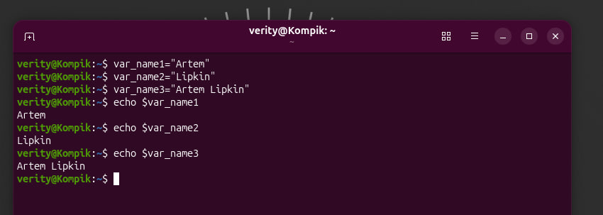

*Рис. 1. Створення змінних `$var_name1`–`$var_name3` та виведення їх командою `echo`*

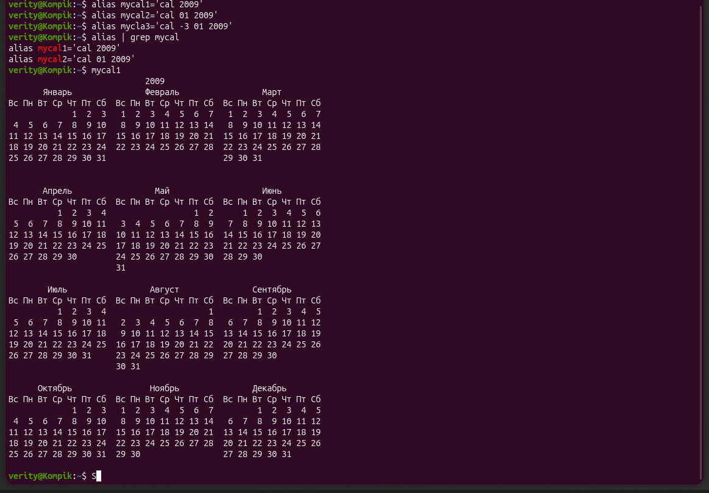

*Рис. 2. Створення псевдонімів, перевірка `alias | grep mycal` та виконання `mycal1` — календар 2009 року*

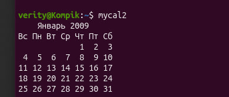

*Рис. 3. Виконання `mycal2` — календар місяця народження (січень 2009)*

На рис. 2 у третьому псевдонімі допущено помилку в імені (`mycla3`), тому `alias | grep mycal` показав лише два псевдоніми. Псевдонім `mycal3` створено повторно з правильним іменем:

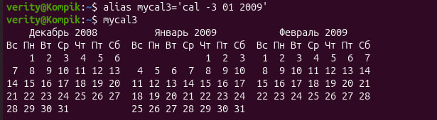

*Рис. 4. Створення псевдоніма `mycal3` та його виконання — грудень 2008, січень 2009, лютий 2009*

#### 2.2. Робота з функціями (Functions) (*)

Функція `students_report` порядково виводить спочатку ім'я та прізвище студента, а потім рік народження:

```bash
var_year1=2009

students_report() {
    echo "Name: $var_name1"
    echo "Surname: $var_name2"
    echo "Full name: $var_name3"
    echo "Year of birth: $var_year1"
}

students_report
type students_report
```

Команда `type students_report` підтверджує, що `students_report` є функцією оболонки, і виводить її тіло.

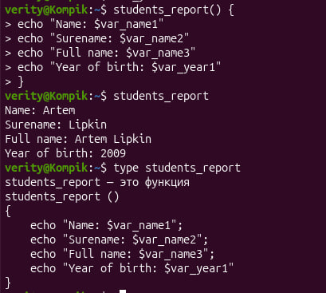

*Рис. 5. Створення функції `students_report`, її виклик і результат `type students_report` («students_report — это функция»)*

#### 2.3. Робота з лапками (Quoting) (*)

Речення 1 — спочатку назви змінних (їх `$` екрановано зворотною косою рискою, тому вони виводяться буквально), потім їх вміст (подвійні лапки підставляють значення):

```bash
echo "We create such variables as \$var_name1, \$var_name2, \$var_name3, which stored our names $var_name1, $var_name2, $var_name3"
```

Той самий результат через комбінацію одинарних (буквальний текст) та подвійних (підстановка) лапок:

```bash
echo 'We create such variables as $var_name1, $var_name2, $var_name3,' "which stored our names $var_name1, $var_name2, $var_name3"
```

Речення 2 — спочатку назви псевдонімів, потім результат їх виконання. Тут використано підстановку команд: зворотні лапки `` ` ` `` та `$( )`. Подвійні лапки зберігають переведення рядків, тому календарі виводяться коректно:

```bash
echo "We create such Aliases as mycal1, mycal2, mycal3, which can show our calendars:
Calendar1:
`mycal1`
Calendar2:
$(mycal2)
Calendar3:
$(mycal3)"
```

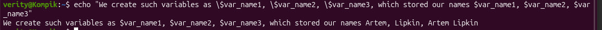

*Рис. 6. Речення 1: екранування `\$` у подвійних лапках — назви змінних виводяться буквально, а значення підставляються*

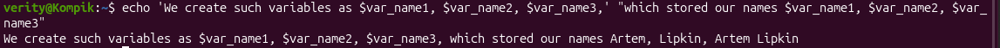

*Рис. 7. Речення 1: комбінація одинарних лапок (буквальний текст) та подвійних (підстановка значень)*

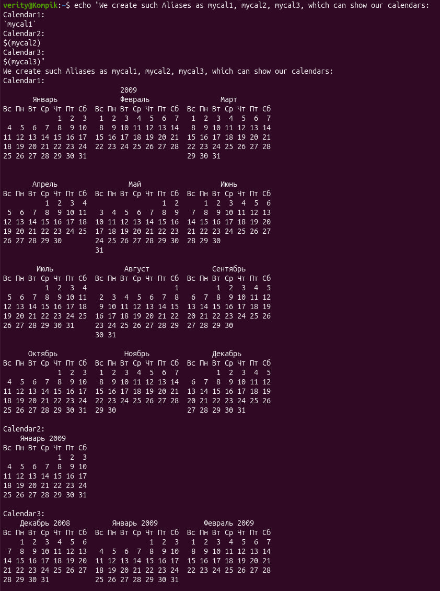

*Рис. 8. Речення 2: назви псевдонімів і результат їх виконання через підстановку команд `` `mycal1` ``, `$(mycal2)`, `$(mycal3)`*

#### 2.4. Робота з інструкціями керування (Control Statements) (**)

**Чи можна завдання 2.1 та 2.2 виконати через інструкції керування без написання окремої функції?** Так. Інструкції керування дозволяють записати кілька команд в одному рядку, тож послідовність команд виконується так само, як тіло функції, але без її оголошення.

Завдання 2.1 одним рядком (`;` — послідовне виконання):

```bash
var_name1="Artem"; var_name2="Lipkin"; var_name3="Artem Lipkin"; echo $var_name1; echo $var_name2; echo $var_name3; alias mycal1='cal 2009' mycal2='cal 01 2009' mycal3='cal -3 01 2009'
```

Завдання 2.2 без функції: спочатку ім'я та прізвище, потім рік народження:

```bash
echo "Name: $var_name1"; echo "Surname: $var_name2"; echo "Full name: $var_name3"; echo "Year of birth: $var_year1"
```

Варіант з `&&` (кожна наступна команда виконується лише після успіху попередньої) та `||` (виконується при помилці):

```bash
echo "Student: $var_name3" && echo "Year of birth: $var_year1" && cal 01 $var_year1 || echo "Error: cal is not installed"
```

> **Примітка.** Псевдонім, створений у рядку, можна використати лише в **наступному** рядку: bash розгортає псевдоніми під час читання рядка, до виконання команди `alias`. Тому в однорядковому варіанті календар викликається напряму як `cal 01 $var_year1`.

Відмінність від функції: функцію визначають один раз і викликають за іменем скільки завгодно разів, а однорядковий ланцюжок команд доводиться вводити (або брати з історії `!n`) щоразу.

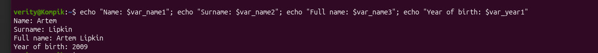

*Рис. 9. Завдання 2.2 без функції: послідовне виконання команд через `;`*

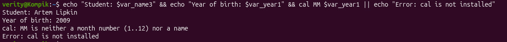

*Рис. 10. Ланцюжок `&&` та `||`: перші дві команди виконано успішно; `cal` отримав некоректний аргумент `MM` і завершився з помилкою, тому спрацювала команда після `||`*

На рис. 10 замість номера місяця введено `MM`, тому `cal` повідомив про помилку (`MM is neither a month number (1..12) nor a name`). Це наочно показує роботу операторів: `&&` передав виконання далі лише після успішних команд, а помилка `cal` запустила команду після `||`.

#### 2.5. Робота з командами довідки (Man Pages)

Отримання довідки по команді `uname`:

```bash
man uname          # повна сторінка довідки (вихід — q)
uname --help       # короткий опис опцій
whatis uname       # однорядковий опис: uname (1) і uname (2)
info uname         # документація GNU coreutils
type uname         # uname is /usr/bin/uname — зовнішня команда
```

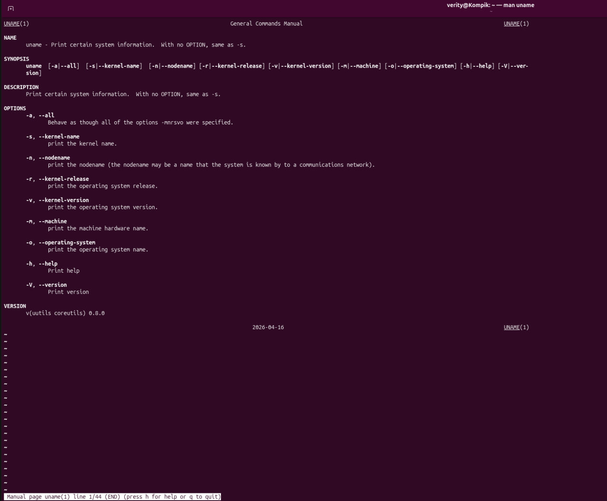

*Рис. 11. Сторінка довідки `man uname`: розділи NAME, SYNOPSIS, DESCRIPTION, OPTIONS, VERSION*

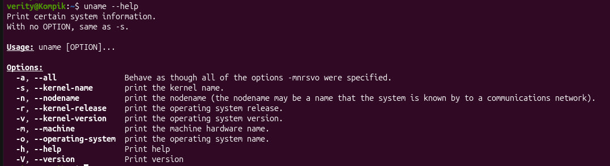

*Рис. 12. Коротка довідка `uname --help` зі списком опцій*

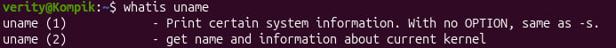

*Рис. 13. `whatis uname`: сторінки довідки `uname (1)` — команда та `uname (2)` — системний виклик*

На основі довідки — 5 варіантів виведення інформації командою `uname` з різними параметрами:

| № | Команда | Що виводить | Результат (рис. 14) |
|---|---|---|---|
| 1 | `uname -s` (`--kernel-name`) | Назва ядра (за замовчуванням) | `Linux` |
| 2 | `uname -n` (`--nodename`) | Мережеве ім'я комп'ютера (хоста) | `Kompik` |
| 3 | `uname -r` (`--kernel-release`) | Випуск (версія) ядра | `7.0.0-34-generic` |
| 4 | `uname -m` (`--machine`) | Апаратна архітектура | `x86_64` |
| 5 | `uname -o` (`--operating-system`) | Назва операційної системи | `GNU/Linux` |

Додатково, за довідкою: `uname -v` (`--kernel-version`) — номер збірки та дата компіляції ядра; `uname -a` (`--all`) — уся інформація разом, як опції `-mnrsvo`. Опції можна поєднувати: `uname -srm` → `Linux 7.0.0-34-generic x86_64`.

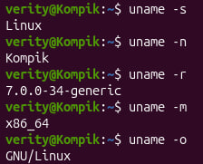

*Рис. 14. Виконання `uname` з п'ятьма різними параметрами: `-s`, `-n`, `-r`, `-m`, `-o`*

---

## 4. Відповіді на контрольні запитання

**1. Які типи команд існують в оболонці Bash?**

| Тип | Опис | Приклад | Що покаже `type` |
|---|---|---|---|
| **Внутрішні (вбудовані, built-in)** | Вбудовані в саму оболонку, виконуються без запуску окремої програми | `cd`, `echo`, `pwd`, `type`, `export`, `alias`, `history` | `cd is a shell builtin` |
| **Зовнішні (external)** | Виконувані файли, які оболонка шукає в каталогах зі змінної `PATH` | `ls`, `date`, `cal`, `uname` | `date is /usr/bin/date` |
| **Псевдоніми (aliases)** | Короткі імена для довших команд | `ll`, `mycal1` | `ll is aliased to 'ls -alF'` |
| **Функції (functions)** | Нові команди з існуючих команд; можуть перевизначати вбудовані та зовнішні | `students_report` | `students_report is a function` |
| **Ключові слова (keywords)** | Зарезервовані слова мови оболонки | `if`, `for`, `while`, `case`, `[[` | `if is a shell keyword` |

Пріоритет пошуку: псевдонім → ключове слово → функція → вбудована команда → зовнішня команда з `PATH`. Усі збіги показує `type -a команда`.

**2. Що таке змінні оточення? Які вони бувають? Як їх можна переглянути в терміналі?**

**Змінні оточення (environment variables)** — змінні, які оболонка передає всім запущеним з неї програмам. Вони задають параметри роботи системи та програм: де шукати команди, мову, домашній каталог, вигляд запрошення тощо.

Види:
- **системні (глобальні)** — встановлюються для всіх користувачів при вході (`/etc/environment`, `/etc/profile`, `/etc/bash.bashrc`);
- **користувацькі** — задаються у файлах `~/.bashrc`, `~/.profile` або вручну командою `export`;
- **сеансові (тимчасові)** — створені `export` у поточному терміналі; зникають після його закриття.

Основні змінні оточення: `PATH` (каталоги пошуку команд), `HOME` (домашній каталог), `USER`/`LOGNAME` (ім'я користувача), `SHELL` (оболонка), `PWD` (поточний каталог), `LANG` (мова й кодування), `TERM` (тип термінала), `HISTSIZE` (розмір історії), `PS1` (запрошення), `EDITOR` (редактор за замовчуванням).

Перегляд:

```bash
env                 
printenv            
echo $HOME          
set                 
export -p           
env | grep LANG     
```

**3. Опишіть змінну `$PS1`. Як у терміналі переглянути її вміст? (*)**

`PS1` (Prompt String 1) — змінна оболонки, що визначає вигляд **основного рядка запрошення**, який bash виводить перед кожною командою. Вона містить звичайний текст і спеціальні послідовності:

| Послідовність | Значення |
|---|---|
| `\u` | Ім'я користувача |
| `\h` / `\H` | Ім'я хоста (коротке / повне) |
| `\w` / `\W` | Поточний каталог (повний шлях / лише назва) |
| `\$` | `$` для звичайного користувача, `#` для root |
| `\d`, `\t`, `\A` | Дата, час (24 год), час ГГ:ХХ |
| `\n` | Новий рядок |
| `\!`, `\#` | Номер команди в історії / в сеансі |
| `\[\e[...m\]` | Керуючі коди кольору (ANSI) |

Існують також `PS2` (запрошення продовження рядка, `> `), `PS3` (для `select`), `PS4` (для налагодження `set -x`).

Перегляд вмісту:

```bash
echo $PS1
echo "$PS1"
declare -p PS1
```

Тому запрошення має вигляд `verity@Kompik:~$`: ім'я та хост зеленим, каталог синім.

**4. Як можна змінити значення змінної `$PS1`? Що при цьому відбудеться в рядку запрошення? Як змінити значення не на поточний сеанс, а за замовчуванням? (*)**

Змінна змінюється звичайним присвоєнням:

```bash
PS1_old="$PS1"                    # зберегти поточне значення
PS1="\u@\h \W> "                  # verity@Kompik ~>
PS1="[\t] \u:\w\$ "               # [15:42:10] verity:~$
PS1="\[\e[1;31m\]\u\[\e[0m\]@\h:\w\$ "   # ім'я користувача червоним
PS1="$PS1_old"                    # повернути попередній вигляд
```

**Що відбудеться:** рядок запрошення одразу, з наступного рядка, змінює вигляд відповідно до нового значення. Зміна діє **лише в поточному сеансі** (вікні термінала): у нових вікнах і після перезапуску повертається стандартне запрошення.

**Зміна за замовчуванням (постійно):** записати присвоєння в кінець файлу `~/.bashrc` (для поточного користувача) і застосувати:

```bash
echo 'PS1="\u@\h \W> "' >> ~/.bashrc
source ~/.bashrc        # або відкрити новий термінал
```

Для всіх користувачів — у `/etc/bash.bashrc` (потрібні права root). Для root — у `/root/.bashrc`.

**5. Для чого використовують лапки в оболонці Bash? (*)**

Лапки повідомляють оболонці, що текст усередині треба обробляти **не так, як зазвичай**: не розбивати на окремі аргументи за пробілами, не розгортати шаблони (`*`, `?`) або, навпаки, підставити результат команди.

| Лапки | Поведінка | Приклад | Результат |
|---|---|---|---|
| `"..."` подвійні | Зберігають пробіли, блокують шаблони, але **підставляють** змінні `$VAR`, команди `$( )` і `` ` ` `` | `echo "Home: $HOME"` | `Home: /home/verity` |
| `'...'` одинарні | Усе всередині — **буквальний текст**, без жодних підстановок | `echo 'Home: $HOME'` | `Home: $HOME` |
| `` `...` `` зворотні | **Підстановка команди**: на місці лапок — результат команди (сучасний аналог — `$( )`) | ``echo "Today is `date +%A`"`` | `Today is Saturday` |
| `\` зворотна коса | Екранує **один** наступний символ | `echo "Price: \$5"` | `Price: $5` |

Застосування: імена файлів з пробілами (`ls "My Documents"`), виведення спецсимволів, побудова повідомлень зі змінними, збереження результату команди в змінну (`today=$(date)`).

**6. Для чого використовують інструкції керування, які їх види ви знаєте? (**)**

**Інструкції керування (control statements, оператори керування)** дозволяють виконувати кілька команд в одному рядку та керувати порядком їх виконання залежно від результату (коду завершення) попередньої команди. Це основа автоматизації та сценаріїв.

Оператори списків команд:

| Оператор | Назва | Поведінка | Приклад |
|---|---|---|---|
| `;` | Крапка з комою | Команди виконуються послідовно незалежно від результату | `cal 1 2030 ; cal 2 2030` |
| `&&` | Логічне «І» | Наступна команда виконується, **лише якщо попередня успішна** (код 0) | `ls /etc/ppp && echo success` |
| `\|\|` | Логічне «АБО» | Наступна команда виконується, **лише якщо попередня завершилась помилкою** | `ls /junk \|\| echo failed` |
| `&` | Фоновий запуск | Команда виконується у фоні | `sleep 60 &` |
| `\|` | Конвеєр | Виведення однієї команди передається на вхід наступної | `history \| grep cal` |
| `( )`, `{ ; }` | Групування | Виконання групи команд у підоболонці / поточній оболонці | `(cd /tmp; ls)` |

Комбінація `&&` і `||` працює як «якщо — інакше»: `ping -c1 8.8.8.8 && echo online || echo offline`.

Керуючі конструкції мови bash (для сценаріїв):
- **умовні:** `if … then … elif … else … fi`, `case … esac`, `test` / `[ ]` / `[[ ]]`;
- **цикли:** `for … do … done`, `while`, `until`, `select`;
- **керування циклом:** `break`, `continue`; вихід: `exit`, `return`.

**7. У чому різниця, якщо в кінці рядка запрошення bash стоїть символ `$` чи `#`? (**)**

- **`$`** — оболонку запущено від імені **звичайного (непривілейованого) користувача**. Його права обмежені: він може змінювати лише свої файли (домашній каталог), а для адміністративних дій потрібен `sudo`.
- **`#`** — оболонку запущено від імені **суперкористувача root** (UID 0) з необмеженими правами: можна змінювати будь-які системні файли, встановлювати ПЗ, керувати користувачами та службами. Помилкова команда може пошкодити систему, тому символ `#` попереджає про підвищену небезпеку.

Символ формує послідовність `\$` у змінній `PS1`: вона автоматично підставляє `#`, якщо UID = 0, і `$` в інших випадках.

У прикладі:
- `[centos@localhost Desktop]$` — користувач `centos` на хості `localhost`, у каталозі `Desktop`, звичайні права;
- `[root@localhost Desktop]#` — той самий каталог, але від імені root (після `su -` або `sudo -i`).

Квадратні дужки та формат `[\u@\h \W]\$` — стандартний вигляд `PS1` в CentOS/RHEL/Fedora; в Ubuntu — `\u@\h:\w\$` (`verity@Kompik:~$`). Перевірити: `whoami`, `id -u` (0 — root).

**8. Яке призначення команд `whereis` та `locate`? Яка між ними відмінність? (**)**

- **`whereis`** знаходить для команди її **виконуваний (двійковий) файл, вихідні коди та сторінки довідки man**. Шукає лише у стандартних системних каталогах (`/bin`, `/usr/bin`, `/sbin`, `/usr/share/man` тощо).
  ```bash
  whereis ls        
  whereis -b ls    
  whereis -m passwd 
  ```
- **`locate`** знаходить **будь-які файли й каталоги** у всій файловій системі, ім'я або шлях яких містить заданий рядок. Шукає дуже швидко, бо використовує заздалегідь створену **базу даних**, яка оновлюється за розкладом або вручну командою `sudo updatedb`. Нові файли не знаходить до оновлення бази. Показує лише файли, до яких користувач має доступ.
  ```bash
  locate passwd           
  locate -c passwd       
  locate -i readme        
  locate -b "\passwd"   
  sudo updatedb          
  ```

| Критерій | `whereis` | `locate` |
|---|---|---|
| Що шукає | Лише двійковий файл, man-сторінки, вихідні коди **команди** | **Будь-які** файли й каталоги за частиною імені |
| Де шукає | Фіксований набір системних каталогів | Уся файлова система (через базу даних) |
| Джерело даних | Безпосередній перегляд каталогів | База даних `updatedb` (може бути застарілою) |
| Кількість результатів | Мало, точно за іменем команди | Може бути дуже багато (часткові збіги) |
| Встановлення | Є за замовчуванням (util-linux) | Окремий пакет `plocate`/`mlocate` |
| Типове застосування | «Де лежить програма і її довідка?» | «Де на диску файл з такою назвою?» |

Для пошуку за складними умовами (розмір, дата, права) у реальному часі використовують `find`.

---

## 5. Висновки

У ході лабораторної роботи я ознайомився з базовими командами CLI-режиму в Linux:

1. Вивчено поняття **оболонки** та **командного інтерпретатора**. Розглянуто структуру рядка запрошення (користувач, хост, поточний каталог, символ `$`/`#`) і загальний формат команди `команда [опції] [аргументи]`. Linux чутливий до регістру.
2. Опрацьовано команди з лабораторних робіт NDG Linux Essentials (Lab 5, Lab 6): `ls` з опціями й аргументами, `whoami`, `uname`, `pwd`, `cd`, `history` та `!n`, `echo` зі змінними, `which`, `type`, `alias`, підстановка команд і лапки, інструкції керування `;`, `&&`, `||`, а також засоби довідки `man`, `info`, `--help`, `whatis`, `apropos`, `whereis`, `locate`. Результати зведено в таблицю.
3. На практиці створено **змінні** з моїм іменем і прізвищем та **псевдоніми** `mycal1`–`mycal3` для виведення календаря року та місяця народження. Розглянуто різницю між локальними змінними та змінними оточення (`env`, `export`, `unset`).
4. Створено **функцію** `students_report`, що порядково виводить ім'я, прізвище та рік народження студента. Функція дозволяє повторно використовувати послідовність команд.
5. Відпрацьовано використання **лапок**: подвійні підставляють змінні та команди, одинарні виводять текст буквально, зворотні лапки та `$( )` підставляють результат команди, `\` екранує символ.
6. Показано, що завдання зі змінними та функцією можна виконати **інструкціями керування** `;`, `&&`, `||` в одному рядку. Встановлено, що псевдонім стає доступним лише з наступного рядка.
7. За допомогою **сторінок довідки** (`man uname`, `uname --help`) вивчено команду `uname` і отримано різну інформацію про систему з опціями `-s`, `-n`, `-r`, `-m`, `-o`, `-a`.
8. У контрольних запитаннях розглянуто типи команд bash, змінні оточення, змінну `PS1` та її постійну зміну через `~/.bashrc`, різницю між `$` і `#` у запрошенні, а також команди `whereis` і `locate`.

Набуті навички роботи з командним рядком є основою для подальшого адміністрування ОС Linux.
