# Звіт з лабораторної роботи №4
>Виконав: Ліпкін Артем

**Дисципліна:** Операційні системи

**Тема:** «Команди Linux для управління процесами»

---

## 1. Мета роботи

1. Отримання практичних навичок роботи з командною оболонкою Bash.
2. Знайомство з базовими командами для управління процесами.

---

## 2. Завдання попередньої підготовки

### 2.1. Словник базових англійських термінів з питань призначення команд та їх параметрів (*)

| Термін (англ.) | Переклад | Пояснення |
|---|---|---|
| Process | Процес | Програма, що виконується, разом із виділеними їй ресурсами (пам'ять, відкриті файли, стан процесора) |
| Process ID (PID) | Ідентифікатор процесу | Унікальний номер процесу в системі |
| Parent process ID (PPID) | Ідентифікатор батьківського процесу | PID процесу, який запустив даний процес |
| Parent / Child process | Батьківський / дочірній процес | Процес, що створює інший процес (`fork`), і створений ним процес |
| Thread | Потік | Окремий потік виконання всередині процесу. Потоки спільно використовують пам'ять процесу (`ps -L`) |
| Session / Session leader | Сеанс / лідер сеансу | Група процесів, пов'язаних з одним терміналом. Лідер сеансу — зазвичай оболонка входу |
| Terminal (TTY, PTS) | Термінал | Пристрій, з якого запущено процес: `tty1` — віртуальна консоль, `pts/0` — псевдотермінал вікна терміналу. `?` — процес без терміналу |
| User ID (UID) | Ідентифікатор користувача | Користувач-власник процесу |
| Effective user ID | Ефективний ідентифікатор користувача | UID, з правами якого фактично працює процес (ключ `-u` команди `ps`) |
| Full / long format listing | Повний / довгий формат виведення | Ключі `-f` та `-l` команди `ps`, які додають стовпці UID, PPID, STIME, PRI, NI тощо |
| Hierarchical format (forest) | Ієрархічний вигляд (дерево) | Виведення процесів у вигляді дерева «батько → нащадки» (`ps -H`, `ps --forest`, `pstree`) |
| Real-time monitoring | Моніторинг у реальному часі | Постійне оновлення інформації про процеси (`top`, `htop`) |
| Load average | Середнє навантаження | Середня кількість процесів, що виконуються або чекають на виконання, за 1, 5 і 15 хвилин |
| Polling interval (delay) | Інтервал оновлення | Період, через який `top` оновлює дані (клавіша `d`, ключ `-d`) |
| Priority (PRI, PR) | Пріоритет | Число, за яким планувальник обирає процес для виконання. Менше значення означає вищий пріоритет |
| Nice value (NI) | Значення «люб'язності» | Поправка до пріоритету від −20 (найвищий) до 19 (найнижчий). Змінюється командами `nice` і `renice` |
| Resident memory (RES, RSS) | Резидентна пам'ять | Обсяг фізичної оперативної пам'яті, яку займає процес |
| Virtual memory (VIRT, VSZ) | Віртуальна пам'ять | Увесь адресний простір процесу (код, дані, бібліотеки, відображені файли) |
| Swap space | Область підкачки | Частина диска, куди ядро вивантажує сторінки пам'яті при її нестачі |
| Process state | Стан процесу | `R` — виконується, `S` — сплячий, `D` — непереривний сон, `T` — зупинений, `Z` — зомбі |
| Zombie process | Процес-зомбі | Процес завершився, але батьківський процес ще не прочитав його код завершення |
| Daemon | Демон | Фоновий системний процес без терміналу (`sshd`, `cron`, `systemd-journald`) |
| Signal | Сигнал | Повідомлення, яке ядро або інший процес надсилає процесу (`SIGTERM`, `SIGKILL`, `SIGSTOP`…) |
| Terminate / Kill | Завершити / знищити | Припинити роботу процесу: м'яко (`TERM`) або примусово (`KILL`) |
| Hang up (HUP) | Розрив з'єднання | Сигнал закриття терміналу. Демони за цим сигналом зазвичай перечитують конфігурацію |
| Interrupt (INT) | Переривання | Сигнал, який надсилає `Ctrl+C` |
| Suspend / Stop | Призупинити | Тимчасово зупинити процес без завершення (`Ctrl+Z`, `SIGTSTP`, `SIGSTOP`) |
| Resume / Continue (CONT) | Відновити | Продовжити виконання зупиненого процесу (`fg`, `bg`, `SIGCONT`) |
| Runaway process | Процес, що вийшов з-під контролю | Процес, який захопив процесор або пам'ять і не реагує на звичайні запити |
| Job | Завдання | Процес або конвеєр, запущений з поточної оболонки. Має номер `%1`, `%2`… (`jobs`) |
| Foreground / Background | Передній / фоновий план | Процес, що займає термінал / працює без блокування термінала (`&`, `bg`) |
| Wildcard | Шаблон (символ підстановки) | `*`, `?` — дозволяють задати групу імен (`killall http*`) |

### 2.2. Відповіді на питання

**2.1. Які команди для моніторингу стану процесів ви знаєте? Як переглянути їх можливі параметри?**

| Команда | Призначення |
|---|---|
| `ps` | Знімок стану процесів на момент виклику |
| `top` | Моніторинг процесів і ресурсів системи в реальному часі |
| `htop` | Інтерактивний, кольоровий аналог `top` (встановлюється окремо: `sudo apt install htop`) |
| `pstree` | Дерево процесів (ієрархія «батько → нащадки») |
| `pgrep`, `pidof` | Пошук PID процесу за іменем (`pgrep -l bash`, `pidof gnome-shell`) |
| `jobs` | Завдання (фонові та зупинені) поточної оболонки |
| `uptime`, `w` | Час роботи системи, кількість користувачів, load average |
| `free -h`, `vmstat 1` | Використання пам'яті та статистика процесора, пам'яті і введення-виведення |
| `/proc` | Віртуальна файлова система, з якої всі ці утиліти беруть дані (`cat /proc/<PID>/status`) |

Параметри команд переглядають так:
- `man ps`, `man top` — повна довідка;
- `ps --help` (або `ps --help all`), `top -h`, `pstree --help` — короткий перелік ключів у терміналі;
- `info ps` — документація GNU (якщо встановлена);
- у запущеному `top` клавіша `h` (або `?`) показує довідку інтерактивних команд, у `htop` — клавіша `F1`.

**2.2. (*) Чи може команда `ps` у реальному часі відслідковувати стан процесів?**

Ні. `ps` виводить **знімок** стану процесів на момент виконання команди і завершується. Щоб побачити зміни, команду потрібно запускати повторно. Для моніторингу в реальному часі призначені `top` і `htop`. Періодичний запуск `ps` можна імітувати командою `watch`:

```bash
watch -n 1 'ps -eo pid,user,%cpu,%mem,cmd --sort=-%cpu | head -15'
```

Тут `watch` перезапускає `ps` щосекунди, але сама `ps` так і залишається командою одного знімка.

**2.3. За якими параметрами можливе сортування процесів у команді `top`? Як переключатись між ними?**

За замовчуванням `top` сортує процеси за **%CPU** (за спаданням). Сортувати можна за будь-яким стовпцем: `PID`, `USER`, `PR`, `NI`, `VIRT`, `RES`, `SHR`, `S`, `%CPU`, `%MEM`, `TIME+`, `COMMAND` та іншими.

| Клавіша в `top` | Дія |
|---|---|
| `Shift+P` | Сортувати за %CPU |
| `Shift+M` | Сортувати за %MEM (пам'ять) |
| `Shift+T` | Сортувати за TIME+ (сумарний час процесора) |
| `Shift+N` | Сортувати за PID |
| `<` / `>` | Перемістити стовпець сортування вліво / вправо |
| `Shift+R` | Змінити напрям сортування (за зростанням ↔ за спаданням) |
| `x` / `b` | Підсвітити стовпець сортування / виділити його жирним |
| `f` (або `F`) | Відкрити екран **Fields Management**: стрілками обрати поле, `s` — зробити його полем сортування, `d` або `Space` — показати/сховати поле, `q` або `Esc` — повернутися |

Поле сортування можна задати й під час запуску: `top -o %MEM`.

Інші корисні клавіші: `d` — змінити інтервал оновлення, `1` — показати кожне ядро процесора окремо, `c` — показати повний командний рядок, `u` — процеси одного користувача, `V` — вигляд дерева, `k` — надіслати сигнал процесу, `r` — змінити nice, `W` — зберегти налаштування в `~/.config/procps/toprc`, `q` — вихід.

**2.4. Які команди для завершення роботи процесів ви знаєте?**

| Команда | Як працює | Приклад |
|---|---|---|
| `kill` | Надсилає сигнал процесу за **PID** або завданню за номером. За замовчуванням `SIGTERM` (15) | `kill 3940`, `kill -9 3940`, `kill -s KILL 3940`, `kill %1` |
| `killall` | Надсилає сигнал усім процесам із заданим **іменем** | `killall firefox`, `killall -s HUP sshd` |
| `pkill` | Надсилає сигнал процесам, що відповідають **шаблону** (regex) імені, користувачу, терміналу тощо | `pkill -u student`, `pkill -f "python app.py"` |
| `xkill` | Завершує графічну програму: курсор стає хрестиком, клік по вікну знищує його процес | `xkill` (працює для X11/XWayland) |
| `top` → `k` | Ввести PID і номер сигналу | `k`, `2345`, `15` |
| `htop` → `F9` | Вибрати процес стрілками і сигнал зі списку | — |
| `Ctrl+C` | Надсилає `SIGINT` процесу переднього плану | — |
| `systemctl stop` | Коректно зупиняє системну службу (демон) | `sudo systemctl stop apache2` |
| `exit`, `logout` | Завершують поточну оболонку | — |

Спочатку краще надсилати `SIGTERM` (15): процес може коректно завершитися, зберегти дані та закрити файли. `SIGKILL` (9) процес не може перехопити чи проігнорувати. Його використовують, лише якщо процес «завис».

> **Примітка до таблиці сигналів.** Номери `STOP`, `TSTP`, `CONT` у теоретичних відомостях (17, 18, 19) взяті з BSD-систем. У Linux на x86/ARM: `SIGCHLD` = 17, `SIGCONT` = 18, `SIGSTOP` = 19, `SIGTSTP` = 20. Актуальний перелік дає команда `kill -l`. Тому сигнали надійніше вказувати **за іменем** (`kill -s STOP`, `kill -CONT`), а не за номером.

---

## 3. Хід роботи

### 3.1. Початкова робота в CLI-режимі

Роботу виконано на власному ПК (п. 1.3): ОС Ubuntu встановлено у віртуальній машині VirtualBox. Характеристики системи:
- ядро Linux `7.0.0-34-generic`;
- 4 віртуальних процесори, 5,3 ГБ оперативної пам'яті, swap 4 ГБ;
- мова системи російська, тому оболонка виводить стани завдань як «Остановлен», «Запущен», «Завершено».

Після входу користувача `verity` на комп'ютері `Kompik` термінал відкрито комбінацією `Ctrl+Alt+T`. У цій версії Ubuntu стандартний термінал — **Ptyxis**. Усі команди виконано в оболонці bash в одному вікні термінала.

### 3.2. Відповіді на питання

**Як вивести вміст директорії `/proc`? Де вона знаходиться та для чого призначена? Охарактеризуйте інформацію про її вміст.**

```bash
ls /proc
cat /proc/version
cat /proc/uptime /proc/loadavg
cat /proc/$$/status | head -12      # $$ — PID поточної оболонки bash
```

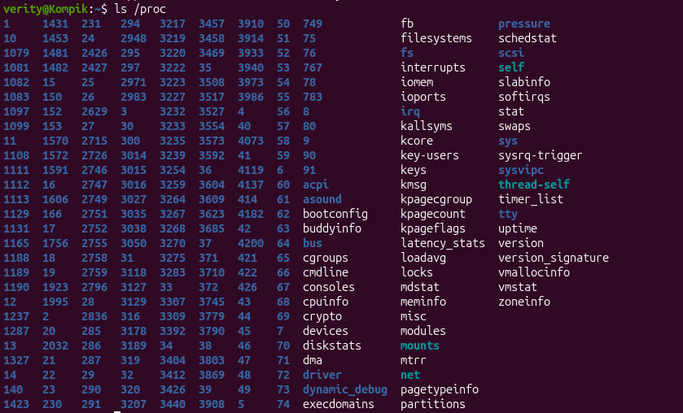

*Рис. 1. Вміст каталогу `/proc`: каталоги з номерами (PID процесів) та системні файли*

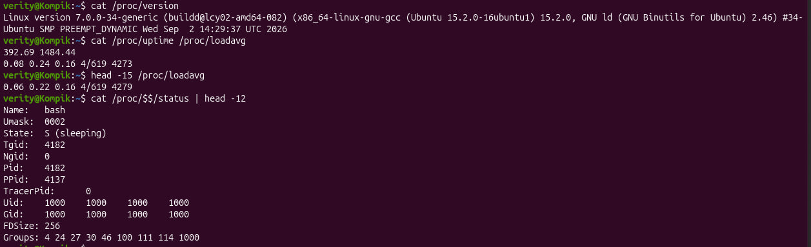

*Рис. 2. Перегляд файлів `/proc/version`, `/proc/uptime`, `/proc/loadavg` та `/proc/$$/status`*

`/proc` знаходиться в **кореневому каталозі** (`/proc`). Це **віртуальна файлова система procfs**: на диску її немає, ядро формує її вміст «на льоту» в оперативній пам'яті під час читання. Тому більшість файлів мають розмір 0 байт, а дані в них щоразу актуальні. `/proc` — інтерфейс між ядром і користувацькими програмами. Звідси беруть дані `ps`, `top`, `htop`, `free`, `uptime`.

На рис. 1 видно дві групи елементів:
- **каталоги з числовими іменами** (`1`, `2`, `1081`, `4182` …) — по одному для кожного процесу, ім'я = PID;
- **файли та каталоги з даними про систему**: `cpuinfo`, `meminfo`, `version`, `uptime`, `loadavg`, `mounts`, `partitions`, `modules`, `interrupts`, `sys`, `net`, а також посилання `self` і `thread-self`.

Результати на рис. 2:
- `/proc/version` — версія ядра `Linux version 7.0.0-34-generic`, компілятор `gcc 15.2.0` і дата збирання ядра;
- `/proc/uptime` — `392.69 1484.44`: система працює 392,69 с (≈ 6,5 хв), друге число — сумарний час простою всіх процесорів;
- `/proc/loadavg` — `0.08 0.24 0.16 4/619 4273`:
  - перші три числа — load average за 1, 5 і 15 хв;
  - `4/619` — 4 потоки виконуються або готові до виконання з 619 наявних;
  - `4273` — PID останнього створеного процесу. Під час другого виклику він уже `4279`: між викликами з'явилися нові процеси (самі команди `cat` і `head`);
- `/proc/$$/status` — дані поточної оболонки:
  - `Name: bash`, `State: S (sleeping)`;
  - `Pid: 4182`, `PPid: 4137` (батьківський процес — `ptyxis-agent` термінала);
  - `Uid`/`Gid: 1000` — звичайний користувач.

Інші файли в `/proc`:
- **у каталозі процесу** `/proc/<PID>/`:
  - `cmdline` — командний рядок, `environ` — змінні оточення;
  - `cwd` → поточний каталог, `exe` → виконуваний файл, `fd/` — відкриті дескриптори;
  - `maps` — карта пам'яті, `limits` — обмеження ресурсів;
- `/proc/self` — посилання на каталог процесу, який його читає;
- **системні файли**: `cpuinfo` — процесор, `meminfo` — пам'ять, `mounts` — змонтовані ФС, `partitions` — розділи дисків, `interrupts` — переривання, `modules` — модулі ядра, `cmdline` — параметри завантаження ядра;
- `/proc/sys/` — параметри ядра, які можна змінювати на льоту (`sysctl`), напр. `/proc/sys/kernel/hostname`, `/proc/sys/vm/swappiness`;
- `/proc/net/` — стан мережевого стеку (`tcp`, `udp`, `dev`).

**Як вивести інформацію про поточні сеанси користувачів? Якою командою це можна зробити?**

```bash
who            # хто увійшов у систему: ім'я, термінал, час входу
w              # хто працює і що виконує + uptime та load average
users          # лише імена користувачів, що увійшли
loginctl list-sessions   # сеанси, зареєстровані systemd-logind
```


*Рис. 3. Виведення команд `who`, `w`, `users`, `loginctl list-sessions`*

Основні команди — `who` та `w`. Команда `w` додатково показує час простою (IDLE), процесорний час (JCPU, PCPU) та команду, яку зараз виконує кожен користувач. Також корисні `who -a` (зокрема час завантаження системи), `whoami` (ім'я поточного користувача) та `last` (історія входів з файлу `/var/log/wtmp`).

У системі працює один користувач `verity`. Його графічний сеанс прив'язаний до віртуальної консолі `tty2` — це видно й у `ps -fu $USER` (рис. 10): процес `gdm-wayland-session` має TTY `tty2`.

**Які дії можна зробити в терміналі за допомогою комбінацій `Ctrl+C`, `Ctrl+D` та `Ctrl+Z`?**

| Комбінація | Що відбувається |
|---|---|
| `Ctrl+C` | Надсилає сигнал **SIGINT** (2) процесу переднього плану — **перериває** (зазвичай завершує) команду. Напр., зупиняє нескінченний `ping` |
| `Ctrl+D` | Надсилає не сигнал, а **кінець введення (EOF)**. Програма, що читає з клавіатури (`cat`, `bc`, `python3`), завершує введення. У порожньому рядку bash — **вихід з оболонки** (як `exit`) |
| `Ctrl+Z` | Надсилає сигнал **SIGTSTP** — **призупиняє** процес переднього плану і повертає запрошення оболонки. Процес стає зупиненим завданням (`[1]+ Остановлен top`, рис. 5), його можна відновити командами `fg` або `bg` |

Додатково: `Ctrl+\` — сигнал SIGQUIT (завершення з дампом пам'яті), `Ctrl+S` / `Ctrl+Q` — зупинка / відновлення виведення в термінал.

**Чим відрізняється фоновий процес від звичайного? Де вони використовуються?**

| | Процес переднього плану (foreground) | Фоновий процес (background) |
|---|---|---|
| Запуск | `команда` | `команда &` або `Ctrl+Z` → `bg` |
| Термінал | Займає термінал: оболонка чекає завершення команди | Термінал вільний, можна виконувати інші команди |
| Введення з клавіатури | Отримує | Не отримує. При спробі читати з терміналу зупиняється (SIGTTIN) |
| Сигнали від `Ctrl+C`, `Ctrl+Z` | Отримує | Не отримує |
| Кількість | Лише один у терміналі | Скільки завгодно |
| Позначка в `ps` (стовпець STAT) | `+` (належить до групи переднього плану), напр. `R+` у рядку `ps` на рис. 14 | Без `+` |

Фонові процеси використовують для довгих операцій, які не потребують взаємодії з користувачем:
- копіювання та архівування великих файлів;
- компіляція, завантаження файлів (`wget … &`);
- запуск сервера чи скрипта під час роботи в тому самому терміналі;
- запуск графічних програм з терміналу (`gedit &`).

Окремий вид фонових процесів — **демони** (служби): вони не прив'язані до жодного терміналу (TTY = `?`) і працюють постійно, наприклад `cron`, `NetworkManager`, `cupsd`, а у віртуальній машині — `VBoxService`. Щоб процес не завершився після закриття терміналу, його запускають через `nohup команда &` або від'єднують командою `disown`.

**Опишіть команди `jobs`, `bg`, `fg`.**

| Команда | Що виконує |
|---|---|
| `jobs` | Виводить список **завдань** поточної оболонки: номер `[n]`, стан (`Запущен`/Running, `Остановлен`/Stopped, `Завершено`/Done, `Завершён`/Terminated) і команду. `+` — поточне завдання, `-` — попереднє. `jobs -l` додає PID, `jobs -p` — лише PID, `jobs -r` / `jobs -s` — лише ті, що виконуються / зупинені |
| `fg [%n]` | Переводить завдання на **передній план** і продовжує його виконання (надсилає SIGCONT). Термінал знову зайнятий цим процесом. Без аргументу — поточне завдання `%+` |
| `bg [%n]` | Продовжує виконання **зупиненого** завдання у **фоновому режимі** (як після `&`). Термінал лишається вільним |

Завдання вказують так: `%1` — за номером, `%+` або `%%` — поточне, `%-` — попереднє, `%ping` — за початком команди. Ці команди вбудовані в bash і працюють лише з процесами, запущеними з **цієї** оболонки.

**Якою командою можна переглянути інформацію про запущені в системі фонові процеси та задачі?**

- Фонові та зупинені **завдання поточної оболонки**: `jobs -l` (рис. 14).
- **Усі процеси** системи: `ps aux` або `ps -ef`. Фонові процеси та демони видно за стовпцем `TTY` (`?` — немає терміналу) і стовпцем `STAT` (немає `+`).
- Лише процеси без керуючого терміналу (демони):
  ```bash
  ps -eo pid,tty,stat,cmd | awk '$2 == "?"' | head
  ```
- Процеси поточного терміналу з їх станами: `ps T` або `ps -o pid,ppid,stat,tty,cmd` (рис. 14).
- Запущені **системні служби**: `systemctl list-units --type=service --state=running`.
- Заплановані задачі: `atq` (одноразові, `at`) та `crontab -l` (періодичні, `cron`).

**Як призупинити фоновий процес, як його потім відновити та при необхідності перезапустити?**

| Дія | Для завдання поточної оболонки | Для будь-якого процесу за PID |
|---|---|---|
| Призупинити | `kill -STOP %1` (або `fg %1`, потім `Ctrl+Z`) | `kill -STOP 4321` або `kill -TSTP 4321` |
| Відновити у фоні | `bg %1` | `kill -CONT 4321` |
| Відновити на передньому плані | `fg %1` | — (лише для завдань своєї оболонки) |
| Завершити | `kill %1` (`kill -9 %1` — примусово) | `kill 4321`, `kill -9 4321` |
| Перезапустити | Завершити і запустити знову: `kill %1; sleep 600 &` | Для служби: `sudo systemctl restart <служба>`. Для демона, що підтримує HUP: `kill -HUP <PID>` (перечитати конфігурацію без перезапуску) |

### 3.3. Робота з процесами в терміналі

#### 1) Команда `top` та аналіз найбільш активних процесів

```bash
top
```

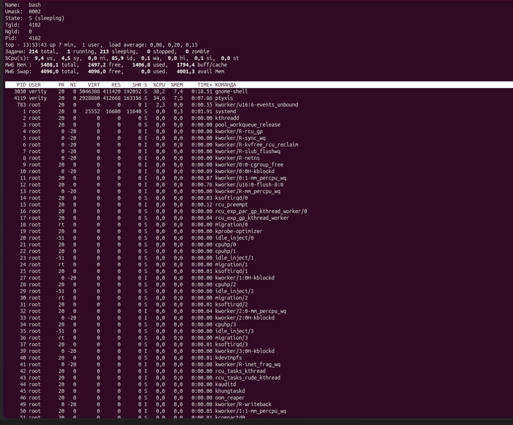

*Рис. 4. Виконання команди `top` (угорі залишився вивід попередньої команди `cat /proc/$$/status`)*

**Аналіз результату.** Верхня частина вікна `top` містить загальну інформацію про систему:
- **рядок 1** — час `13:53:43`, система працює 7 хв (`up 7 min`), 1 користувач. Load average `0,08, 0,20, 0,15` значно менший за кількість процесорів (4), тому система майже не навантажена;
- **рядок 2 (`Задачи`)** — 214 процесів: 1 виконується (`running`), 213 сплять (`sleeping`), зупинених і зомбі немає;
- **рядок 3 (`%Cpu(s)`)**:
  - `us` 9,4 % — користувацькі процеси, `sy` 4,5 % — ядро;
  - `id` 85,9 % — процесор переважно простоює;
  - `wa` 0,1 % — очікування введення-виведення майже відсутнє;
- **`МиБ Mem`** — 5408,1 МіБ пам'яті: 1406,8 зайнято, 2497,2 вільно, 1794,4 — буфери й кеш файлів. `avail Mem` 4001,3 МіБ — стільки можуть отримати нові програми;
- **`МиБ Swap`** — 4096 МіБ, використано 0, бо оперативної пам'яті достатньо.

Найбільш активні процеси (таблиця відсортована за `%CPU`):
- **`gnome-shell`** (PID 3050, власник `verity`) — 38,2 % CPU, 7,4 % пам'яті (RES ≈ 402 МіБ). Графічна оболонка GNOME: малює інтерфейс і композитує вікна. У віртуальній машині без апаратного прискорення графіки малювання виконує процесор, тому навантаження помітне;
- **`ptyxis`** (PID 4119) — 34,6 % CPU, 7,5 % пам'яті. Емулятор термінала, у якому працює `top`: він постійно перемальовує вікно з виводом;
- **`kworker/u16:6-events_unbound`** (PID 783, `root`) — 2,3 % CPU. Робочий потік ядра, виконує відкладені завдання ядра;
- **`systemd`** (PID 1) — 0,3 % пам'яті, процесор не використовує.

Інші рядки — потоки ядра (`kthreadd`, `kworker`, `ksoftirqd`, `migration`, `rcu_*`) з нульовим використанням CPU і пам'яті. Більшість у стані `S` (sleeping) або `I` — простоюючий потік ядра (idle). Деякі мають особливі пріоритети:
- `kworker/R-*` — `PR 0`, `NI -20` (найвищий звичайний пріоритет);
- `migration/*` — `rt` (планування реального часу);
- `ksmd` — `NI 5`, `khugepaged` — `NI 19` (найнижчий пріоритет).

Висновок: процесор навантажують лише графічна оболонка та термінал, решта процесів чекає подій. Система працює в нормальному режимі з великим запасом пам'яті.

#### 2) Призупинення виконання команди `top`

Під час роботи `top` натиснуто `Ctrl+Z`. Процес отримав сигнал SIGTSTP і перейшов у стан **зупинено**, а оболонка вивела `[1]+  Остановлен    top`.


*Рис. 5. Призупинення `top` комбінацією `Ctrl+Z`*

#### 3) Виведення інформації про процеси командою `ps`

```bash
ps
```

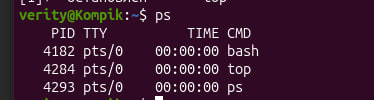

*Рис. 6. Виконання команди `ps` без параметрів*

Без параметрів `ps` показує лише процеси поточного користувача в поточному терміналі `pts/0`:
- оболонку `bash` (PID 4182);
- призупинений `top` (PID 4284);
- сам `ps` (PID 4293).

Стовпці: `PID` — ідентифікатор, `TTY` — термінал, `TIME` — використаний час процесора, `CMD` — команда.

#### 4) (*) Приклади використання різних параметрів команди `ps`

**Приклад 1. Усі процеси системи в повному форматі**

```bash
ps -ef | head -20
```

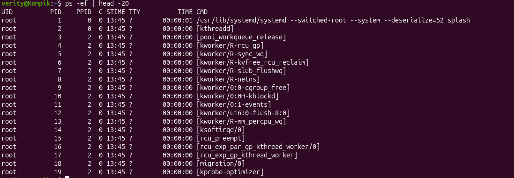

*Рис. 7. `ps -ef` — усі процеси в повному форматі (перші 20 рядків)*

`-e` — усі процеси системи (те саме, що `-A`), `-f` — повний формат зі стовпцями `UID`, `PID`, `PPID`, `C`, `STIME`, `TTY`, `TIME`, `CMD`. `head -20` обмежує виведення першими 20 рядками.

Що видно на рис. 7:
- PID 1 — `/usr/lib/systemd/systemd` (init), PID 2 — `kthreadd`. В обох `PPID = 0`: їх створює саме ядро;
- усі наступні процеси (`kworker`, `ksoftirqd`, `rcu_preempt`, `migration`…) мають `PPID = 2` — це потоки ядра. Їхні імена в квадратних дужках, а `TTY = ?`;
- `STIME 13:45` — система завантажилася о 13:45.

**Приклад 2. Лише системні процеси (власник root) і потоки ядра**

```bash
ps -U root -u root -f | head -15     # процеси користувача root (реальний та ефективний UID)
ps --ppid 2 | head                   # потоки ядра — нащадки kthreadd (PID 2)
```

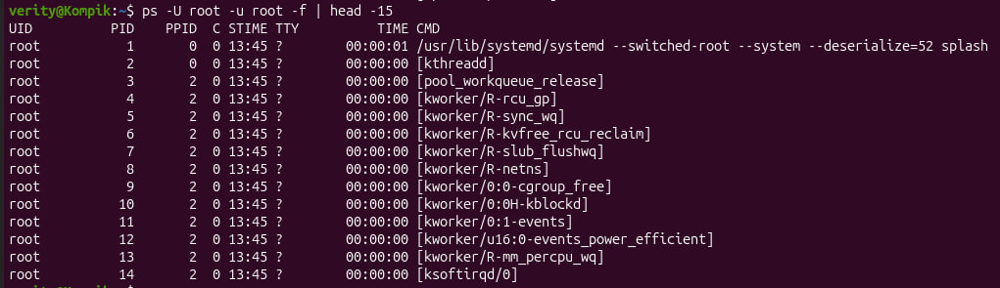

*Рис. 8. `ps -U root -u root -f` — процеси, що працюють від імені root*

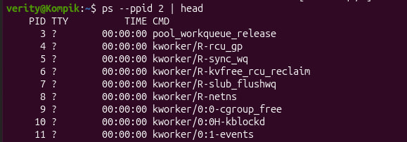

*Рис. 9. `ps --ppid 2` — потоки ядра*

`-U root` — фільтр за реальним UID, `-u root` — за ефективним UID. Разом вони відбирають процеси, які запущені від імені root і працюють з його правами: `systemd` та потоки ядра. `--ppid 2` виводить процеси, батьком яких є `kthreadd`, тобто лише потоки ядра (`pool_workqueue_release`, `kworker/R-rcu_gp`, `kworker/R-netns` …).

**Приклад 3. Процеси конкретного користувача**

```bash
ps -fu $USER
```

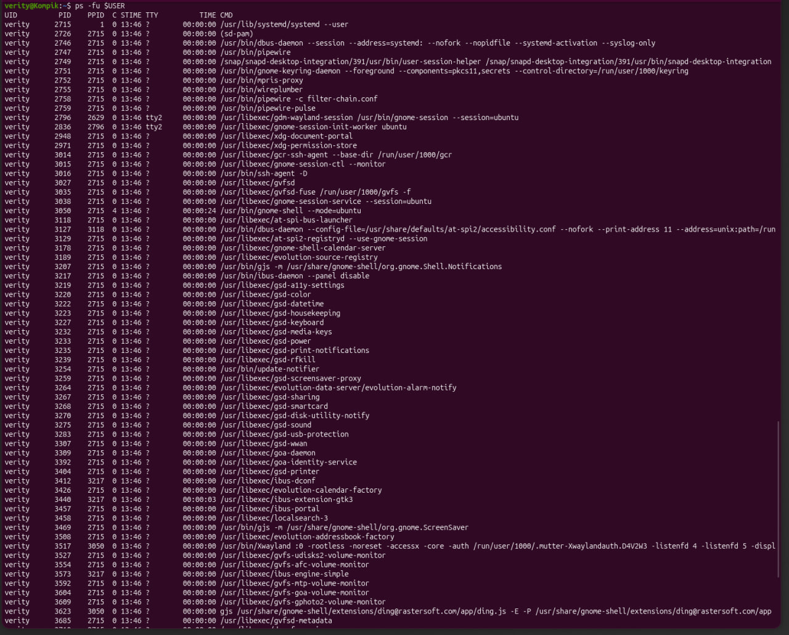

*Рис. 10. `ps -fu $USER` — процеси користувача `verity`*

`-u $USER` — процеси, ефективний власник яких — поточний користувач (змінна `$USER` = `verity`). `-f` — повний формат.

Видно процеси графічного сеансу:
- `systemd --user` (PID 2715, `PPID 1`) — менеджер сеансу користувача. Він є батьком більшості процесів сеансу (`PPID 2715`);
- `pipewire`, `wireplumber` — звук; `dbus-daemon --session` — шина повідомлень;
- `gnome-shell` (PID 3050) та запущений ним `Xwayland` (PID 3517, `PPID 3050`);
- служби налаштувань GNOME `gsd-*`, `evolution-*`, `gvfs-*`, `ibus-*`.

Лише `gdm-wayland-session` та `gnome-session-init-worker` мають термінал `tty2` — на цій віртуальній консолі працює графічний сеанс.

**Приклад 4. Дерево процесів**

```bash
ps -ef --forest | tail -25
```

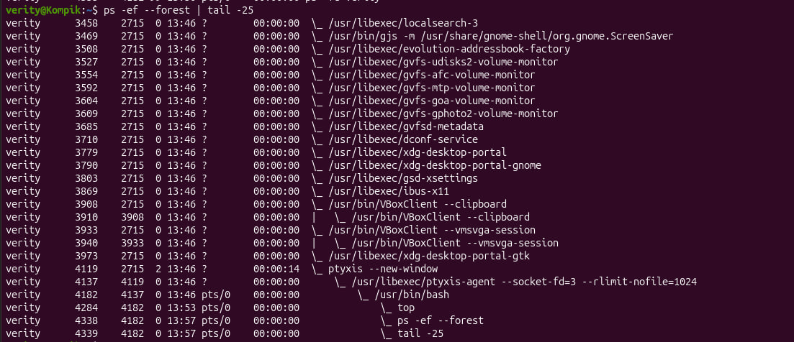

*Рис. 11. Дерево процесів `ps -ef --forest` (останні 25 рядків)*

`--forest` малює ASCII-дерево (`\_`), де нащадки зсунуті під своїм батьком. Аналогічний результат дають `ps -ejH` (ієрархія відступами) і `ps axjf`.

На рис. 11 видно ланцюжок процесів термінала: `ptyxis --new-window` (4119) → `ptyxis-agent` (4137) → `/usr/bin/bash` (4182) → `top` (4284), `ps -ef --forest` (4338), `tail -25` (4339). Команди `ps` і `tail`, з'єднані конвеєром, — два окремі процеси-нащадки однієї оболонки. Також видно процеси гостьових доповнень VirtualBox (`VBoxClient --clipboard`, `VBoxClient --vmsvga-session`).

**Приклад 5. Вибрані стовпці і сортування за використанням пам'яті**

```bash
ps -eo pid,ppid,user,stat,%cpu,%mem,rss,cmd --sort=-%mem | head -10
```

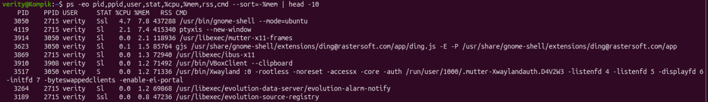

*Рис. 12. Процеси з найбільшим використанням пам'яті*

`-o` задає власний набір стовпців:
- `pid`, `ppid`, `user` — PID, батьківський PID і власник;
- `stat` — стан;
- `%cpu`, `%mem` — частка процесора і пам'яті;
- `rss` — резидентна пам'ять у КБ;
- `cmd` — команда.

`--sort=-%mem` сортує за спаданням використання пам'яті (`-` — за спаданням).

Найбільше пам'яті споживають:
- `gnome-shell` — 7,8 % (RSS 437 288 КБ ≈ 427 МіБ);
- `ptyxis` — 7,4 % (415 340 КБ);
- `mutter-x11-frames` — 2,1 %;
- `gjs … ding.js` (значки на робочому столі) — 1,5 %;
- далі `ibus-x11`, `VBoxClient`, `Xwayland` — по 1,2–1,3 %.

У стовпці `STAT`: `S` — сплячий, `s` — лідер сеансу, `l` — багатопотоковий процес.

**Приклад 6. Потоки процесу**

```bash
ps -L -C gnome-shell | head
```

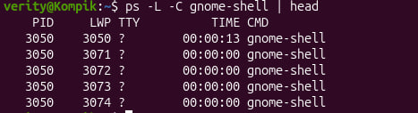

*Рис. 13. Потоки процесу `gnome-shell`*

`-C gnome-shell` відбирає процеси за іменем команди. `-L` показує кожен потік окремим рядком: стовпець `LWP` (light-weight process) — ідентифікатор потоку. Усі рядки мають однаковий `PID 3050`, але різні `LWP` (3050, 3071, 3072 …). Отже, `gnome-shell` — багатопотоковий процес, а головний потік має `LWP = PID`.

#### 5) (**) Запущені фонові процеси

```bash
sleep 600 &
ping -c 1000 127.0.0.1 > /dev/null &
jobs -l
ps -o pid,ppid,stat,tty,cmd
```

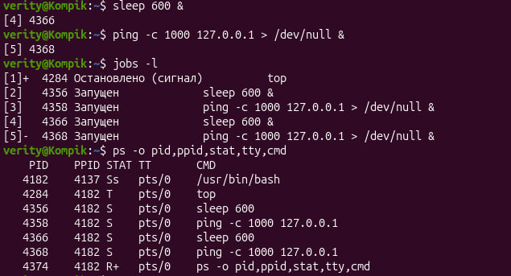

*Рис. 14. Перелік фонових і зупинених завдань (`jobs -l`) та їх стан у `ps`*

Команди `sleep 600 &` і `ping … &` було виконано двічі, тому в оболонці п'ять завдань. Після запуску з `&` оболонка виводить номер завдання і PID (`[4] 4366`, `[5] 4368`).

| Завдання | PID | Команда | Стан у `jobs` | `STAT` у `ps` |
|---|---|---|---|---|
| `[1]+` | 4284 | `top` | Остановлено (сигнал) | `T` — зупинений |
| `[2]` | 4356 | `sleep 600` | Запущен | `S` — спить |
| `[3]` | 4358 | `ping -c 1000 127.0.0.1` | Запущен | `S` |
| `[4]` | 4366 | `sleep 600` | Запущен | `S` |
| `[5]-` | 4368 | `ping -c 1000 127.0.0.1` | Запущен | `S` |

Усі завдання мають `PPID 4182` — це нащадки оболонки `bash`, а `bash` має стан `Ss` (лідер сеансу). Знак `+` у `STAT` є лише в `ps` (`R+`), бо тільки він працює на передньому плані. Крім завдань оболонки, у системі постійно працюють фонові демони без терміналу (`TTY = ?`, рис. 7–10).

#### 6) Відновлення призупиненого процесу на передньому плані, повторна зупинка та відновлення у фоні

```bash
fg %1          # top знову на передньому плані й оновлює екран
# Ctrl+Z       # повторно призупиняємо
bg %1          # відновлюємо top у фоновому режимі
jobs -l
```

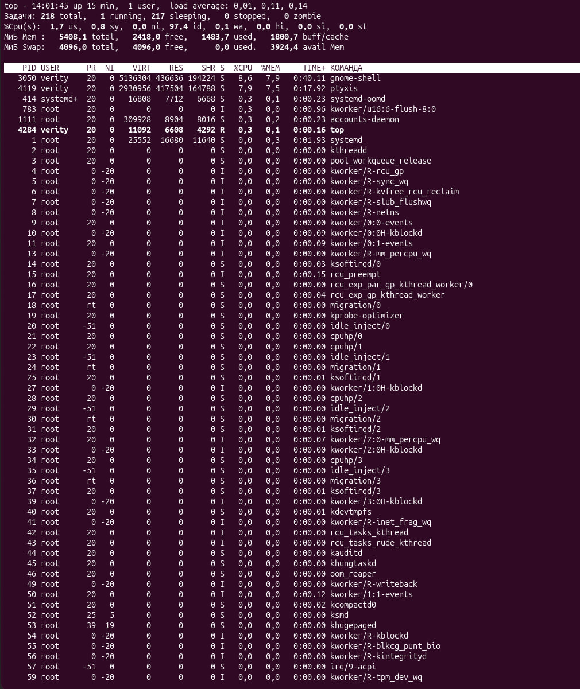

*Рис. 15. `fg %1` — `top` відновлено на передньому плані: він знову оновлює дані (час 14:01:45, `up 15 min`) і показує себе в рядку зі станом `R`*

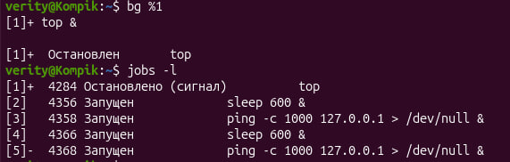

*Рис. 16. Після повторної зупинки `Ctrl+Z` — команда `bg %1` та стан завдань*

Після `bg %1` оболонка виводить `[1]+ top &`, тобто `top` продовжив роботу у фоні. Але одразу з'являється `[1]+ Остановлен top`, а `jobs -l` показує `Остановлено (сигнал)`. Причина в тому, що `top` — інтерактивна програма: їй потрібен термінал для виведення та читання клавіш. Фоновий процес при спробі змінити налаштування термінала або читати з нього отримує від ядра сигнал **SIGTTOU/SIGTTIN** і зупиняється. Тому інтерактивні програми у фоні не працюють.

Неінтерактивна програма у фоні працює нормально. Перевіримо це на завданні `[2]` `sleep 600`:

```bash
fg %2          # sleep на передньому плані (термінал зайнятий)
# Ctrl+Z       # [2]+  Остановлен  sleep 600
bg %2          # [2]+ sleep 600 &
jobs -l        # [2]  4356 Запущен  sleep 600 &
```

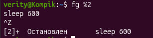

*Рис. 17. `fg %2` — `sleep 600` на передньому плані, зупинка `Ctrl+Z` (`^Z`)*

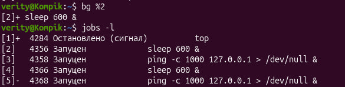

*Рис. 18. `bg %2` — `sleep 600` продовжує роботу у фоні, стан `Запущен`*

#### 7) Завершення роботи фонових процесів

```bash
kill %1           # SIGTERM для top
kill %2 %3        # завершуємо sleep і ping
jobs
ps
```

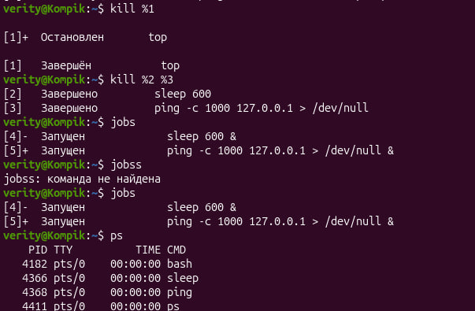

*Рис. 19. Завершення фонових процесів командою `kill` і перевірка `jobs`, `ps`*

Результат:
- після `kill %1` оболонка виводить `[1] Завершён top`. Зупинений процес не може обробити SIGTERM, тому bash для завдань у стані Stopped після сигналу TERM додатково надсилає SIGCONT. Процес продовжує роботу, отримує SIGTERM і завершується;
- `kill %2 %3` — `[2] Завершено sleep 600`, `[3] Завершено ping …`;
- `jobs` показує лише повторно запущені завдання `[4]` і `[5]`, а `ps` — що `top` (4284) і процеси 4356, 4358 зникли.

Завдання `[4]` і `[5]` завершуються самі: `sleep 600` — через 10 хв, `ping -c 1000` — після 1000 пакетів. Їх можна завершити так само: `kill %4 %5`. Якщо процес не реагує на SIGTERM, його завершують примусово: `kill -9 %1` або `kill -KILL <PID>`. Те саме можна зробити за PID (`kill 4366`) або за іменем (`killall sleep`, `pkill ping`).

---

## 4. Відповіді на контрольні запитання

**1. Яке призначення директорії `/proc` в системах Linux? Яку інформацію вона зберігає?**

`/proc` — **віртуальна файлова система (procfs)**, яку ядро монтує в `/proc`. Вона не займає місця на диску: її файли ядро генерує під час читання. Це «вікно» в структури даних ядра — через неї програми (`ps`, `top`, `free`, `lsblk`, `uptime`) отримують інформацію про процеси та систему. Через `/proc/sys` також можна змінювати параметри ядра на льоту.

Інформація, яку зберігає `/proc`:
- **про кожен процес** — каталог `/proc/<PID>/`:
  - `status`, `stat` — стан, пам'ять, PPID, UID;
  - `cmdline` — командний рядок, `environ` — змінні оточення;
  - `fd/` — відкриті файли;
  - `cwd`, `exe` — поточний каталог і виконуваний файл;
  - `maps` — карта пам'яті, `limits` — обмеження ресурсів;
- **про апаратне забезпечення**: `cpuinfo`, `meminfo`, `interrupts`, `devices`, `partitions`, `bus/`;
- **про ядро та систему**:
  - `version`, `cmdline` — версія та параметри завантаження ядра;
  - `uptime`, `loadavg`, `stat` — час роботи та навантаження;
  - `modules` — модулі ядра, `filesystems` — підтримувані ФС, `mounts` — змонтовані ФС;
  - `swaps` — області підкачки;
- **налаштування ядра**: `/proc/sys/` (`kernel/hostname`, `vm/swappiness`, `net/ipv4/ip_forward`);
- **стан мережі**: `/proc/net/` (`tcp`, `udp`, `dev`, `route`).

**2. Як серед будь-яких трьох процесів динамічно визначати, який з них у поточний момент використовує найбільший обсяг пам'яті? Який відсоток пам'яті він споживає від загального обсягу?**

Найзручніше — `top` у режимі спостереження за вибраними PID з сортуванням за пам'яттю:

```bash
pidof gnome-shell                                 # дізнатися PID процесу за іменем
top -p 1,$(pidof -s gnome-shell),$$ -o %MEM       # systemd, gnome-shell і поточний bash; сортування за %MEM
```

Тут `1` — PID процесу `systemd`, `$(pidof -s gnome-shell)` — оболонка підставляє PID `gnome-shell`, `$$` — PID поточної оболонки `bash`.

Ключ `-p` обмежує `top` вказаними PID (до 20). `-o %MEM` (або клавіша `Shift+M` у запущеному `top`) сортує за пам'яттю. Дані оновлюються кожні 3 с (змінити — `-d 1` або клавіша `d`). Процес у **першому рядку** в поточний момент споживає найбільше пам'яті. Стовпець **`%MEM`** показує його частку від загального обсягу фізичної пам'яті, `RES` — абсолютний обсяг.

Альтернатива — `ps` з періодичним оновленням через `watch`:

```bash
watch -n 1 "ps -o pid,comm,rss,%mem -p 1,$(pidof -s gnome-shell),$$ --sort=-%mem"
```

У `htop` для цього вибрати процеси і натиснути `F6` → `PERCENT_MEM` (або фільтр `F4`).

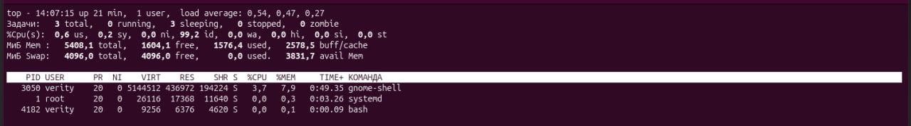

*Рис. 20. `top -p 1,$(pidof -s gnome-shell),$$ -o %MEM` — порівняння трьох процесів за використанням пам'яті*

На рис. 20 `top` показує лише три процеси (`Задачи: 3 total`), відсортовані за `%MEM`:

| PID | Процес | RES, КіБ | RES, МіБ | %MEM |
|---|---|---|---|---|
| 3050 | `gnome-shell` | 436 972 | ≈ 426,7 | **7,9** |
| 1 | `systemd` | 17 368 | ≈ 17,0 | 0,3 |
| 4182 | `bash` | 6 376 | ≈ 6,2 | 0,1 |

Найбільше пам'яті з трьох процесів у цей момент використовує **`gnome-shell`** — **7,9 %** від загального обсягу.

Перевірка розрахунком: `%MEM = RES / MemTotal × 100 %`. Загальний обсяг пам'яті з рядка `МиБ Mem` — 5408,1 МіБ:

426,7 МіБ / 5408,1 МіБ × 100 % ≈ **7,9 %**

Значення збігається з тим, що показує `top`.

**3. Як отримати ієрархію батьківських процесів у системах Linux? Наведіть її структуру та охарактеризуйте.**

Команди:
- `pstree` — дерево процесів; `pstree -p` — з PID, `pstree -u` — зі зміною користувача, `pstree -s $$` — лише гілка від PID 1 до поточної оболонки;
- `ps -ef --forest`, `ps axjf`, `ps -ejH` — дерево у форматі `ps`;
- `top` → клавіша `V` (Forest view), `htop` → `F5` (Tree);
- PPID конкретного процесу: `ps -o ppid= -p <PID>` або рядок `PPid` у `/proc/<PID>/status`.

```bash
pstree -p | head -40
pstree -s -p $$
```

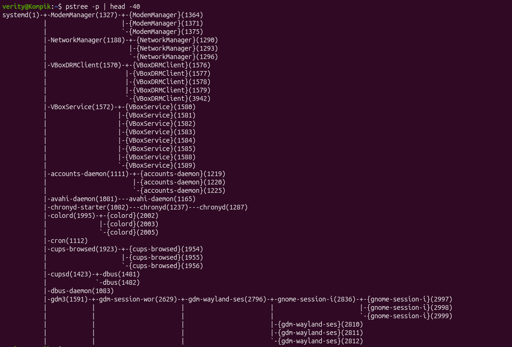

*Рис. 21. Дерево процесів `pstree -p` (перші 40 рядків)*

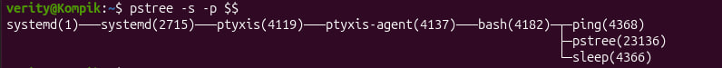

*Рис. 22. Гілка дерева від `systemd` до поточної оболонки: `pstree -s -p $$`*

На рис. 21 коренем дерева є `systemd(1)`. Його прямі нащадки — системні демони:
- `ModemManager`, `NetworkManager` — мережа;
- `VBoxDRMClient`, `VBoxService` — гостьові доповнення VirtualBox;
- `accounts-daemon`, `avahi-daemon`, `chronyd` (синхронізація часу), `colord`, `cron`, `cups-browsed`, `cupsd` (друк), `dbus-daemon`;
- `gdm3` — менеджер входу.

Записи у фігурних дужках `{NetworkManager}(1290)` — це **потоки** процесу, а не окремі процеси. Ланцюжки `---` показують батьківські зв'язки, наприклад `chronyd-starter(1082)---chronyd(1237)---chronyd(1287)`.

Рис. 22 показує гілку поточної оболонки: `systemd(1)` → `systemd(2715)` (менеджер сеансу користувача) → `ptyxis(4119)` → `ptyxis-agent(4137)` → `bash(4182)` → `ping(4368)`, `pstree(23136)`, `sleep(4366)`.

Узагальнена структура дерева процесів Ubuntu з GNOME (за рис. 10, 11, 21, 22):

```
systemd(1)                         ← init: перший процес користувацького простору
 ├─ NetworkManager, ModemManager, cron, cupsd, chronyd, dbus-daemon …   ← системні демони
 ├─ VBoxService, VBoxDRMClient     ← служби VirtualBox у гостьовій ОС
 ├─ gdm3 ─ gdm-session-worker ─ gdm-wayland-session ─ gnome-session-init-worker   (tty2)
 └─ systemd --user (2715)          ← менеджер служб сеансу користувача verity
     ├─ gnome-shell (3050) ─ Xwayland (3517)
     ├─ pipewire, wireplumber, dbus-daemon --session, gsd-* …
     └─ ptyxis (4119) ─ ptyxis-agent (4137) ─ bash (4182) ─ top, sleep, ping, pstree …
kthreadd(2)                        ← батько потоків ядра: kworker, ksoftirqd, migration …
```

Характеристика:
- кожен процес, крім PID 0 (`idle`/`swapper` у ядрі), має **рівно одного батька** (PPID) і може мати багато **нащадків**. Нові процеси створюються системним викликом `fork()` (копія батька), після чого зазвичай виконується `exec()` (заміна програми);
- **PID 1 — `systemd`** (раніше `init`) запускає всі служби, тому є коренем дерева;
- **PID 2 — `kthreadd`** породжує потоки ядра (у `ps` їх назви в квадратних дужках);
- якщо батько завершується раніше за нащадка, «сирота» передається на виховання PID 1 (або процесу-subreaper, напр. `systemd --user`);
- процес, що завершився, але батько ще не прочитав його код завершення (`wait()`), стає **зомбі** (стан `Z`);
- сигнали та завершення сеансу поширюються вниз по дереву: закриття терміналу надсилає SIGHUP оболонці та її завданням.

**4. Чим відрізняється команда `top` від `ps`?**

| Критерій | `ps` | `top` |
|---|---|---|
| Режим роботи | Одноразовий **знімок** стану процесів, після виведення завершується | **Динамічне** оновлення в реальному часі (за замовчуванням кожні 3 с) |
| Інтерактивність | Неінтерактивна | Інтерактивна: сортування, фільтрація, зміна полів, надсилання сигналів (`k`), зміна пріоритету (`r`) |
| Загальна інформація про систему | Немає | Uptime, load average, кількість задач за станами, завантаження CPU, пам'ять і swap |
| Обсяг виведення | Усі вибрані процеси, скільки б їх не було | Лише ті, що вміщуються на екран (за замовчуванням — найактивніші) |
| Сортування за замовчуванням | За PID / порядком створення | За %CPU |
| Використання в скриптах і конвеєрах | Зручно (`ps … \| grep`, `awk`), гнучкий формат `-o` | Лише в пакетному режимі `top -b -n 1` |
| Синтаксис параметрів | Три стилі: Unix (`-ef`), BSD (`aux`), GNU (`--forest`) | Ключі запуску (`-d`, `-p`, `-u`, `-o`) та клавіші під час роботи |
| Типове застосування | Знайти процес і його PID, отримати список для обробки | Спостерігати за навантаженням і знайти процес, що «з'їдає» ресурси |

**5. Які додаткові можливості реалізує `htop` порівняно з `top`?**

- **Кольоровий інтерфейс** і графічні індикатори завантаження кожного ядра процесора, пам'яті та swap у заголовку;
- **прокрутка** списку процесів вертикально й горизонтально — видно всі процеси та повні командні рядки;
- **керування мишею**: клік по процесу, заголовку стовпця для сортування, кнопках F-меню;
- **меню функціональних клавіш** внизу екрана:
  - `F1` — довідка, `F2` — налаштування (Setup);
  - `F3` — пошук, `F4` — фільтр;
  - `F5` — дерево процесів, `F6` — вибір поля сортування;
  - `F7`/`F8` — змінити nice, `F9` — kill, `F10` — вихід;
- **виділення кількох процесів** (`Space`) і надсилання сигналу всім одразу; вибір сигналу зі списку за назвою, без запам'ятовування номерів;
- пошук і фільтрація процесів за іменем «на льоту»;
- `u` — процеси одного користувача, `t`/`F5` — дерево, `H` — показати/сховати потоки користувачів, `K` — потоки ядра;
- `l` — відкриті файли процесу (через `lsof`), `s` — трасування системних викликів (через `strace`);
- `I` — змінити напрям сортування, `F` — слідувати за обраним процесом;
- гнучке налаштування (`F2`): вигляд заголовка, лічильники (температура, мережа, диск, батарея), колонки, кольорові схеми. Налаштування зберігаються в `~/.config/htop/htoprc`;
- показ стовпців введення-виведення (IO), cgroup, контейнерів та ін.

`htop` не встановлено за замовчуванням: `sudo apt install htop`.

**6. Опишіть компоненти вашої мобільної ОС для здійснення моніторингу запущених у системі процесів.**

Смартфон **Samsung Galaxy S25 Ultra**, ОС **Android 17** з оболонкою **One UI 9**. Android побудований на ядрі Linux, тому процеси, PID, сигнали та `/proc` в ньому ті самі, але користувач керує ними не напряму, а через системні компоненти.

Системні компоненти (рівень ОС):
- **Ядро Linux** — планувальник, cgroups (поділ програм на групи foreground / background / cached), `/proc`;
- **Zygote** — процес, від якого через `fork()` створюються процеси всіх програм. Кожна програма працює у власному процесі під власним UID (пісочниця);
- **ActivityManagerService** (частина `system_server`) — відстежує життєвий цикл програм і їх пріоритет (oom_adj): видима програма, служба, кешований процес;
- **lmkd (Low Memory Killer Daemon)** — при нестачі пам'яті автоматично завершує найменш важливі кешовані процеси;
- **Battery / Power Manager, App Standby Buckets** — обмежують фонову активність програм.

Інструменти моніторингу для користувача в One UI:
- **Екран «Останні програми»** (кнопка або жест «Огляд») — список запущених програм. Закрити програму — змахнути картку вгору, кнопка **«Закрити всі»**;
- **Активні програми** — кнопка внизу панелі швидких налаштувань: програми з активними фоновими службами (музика, навігація, VPN), кнопка «Зупинити»;
- **Налаштування → Обслуговування пристрою → Пам'ять** — використання ОЗП, кнопка «Очистити»; там же **Акумулятор** — витрата заряду програмами у фоні;
- **Налаштування → Акумулятор → Обмеження використання у фоні** — списки «Сплячі програми», «Програми в глибокому сні» та «Ніколи не сплячі програми»;
- **Налаштування → Програми → [програма] → Примусово зупинити** — аналог `kill` для конкретної програми, а також перегляд використання пам'яті та акумулятора;
- **Параметри розробника** (вмикаються в **Налаштування → Відомості про телефон → Відомості про ПЗ** семикратним натисканням на «Номер збірки»):
  - **«Запущені служби»** — процеси та служби в реальному часі з обсягом ОЗП, можна зупинити службу;
  - **«Пам'ять»** — статистика використання пам'яті за 3/6/12/24 год;
  - «Ліміт фонових процесів», «Не зберігати дії»;
  - графічні профілювальники (GPU-рендеринг).

**7. Чи підтримує ваша мобільна ОС термінальне керування роботою процесів? Опишіть, як саме.**

Так, але з обмеженнями. Android містить командну оболонку `sh` (mksh) та набір утиліт **toybox** (`ps`, `top`, `kill`, `pidof`, `cat /proc/...`), проте вбудованого термінала для користувача One UI не має. Способи доступу:

1. **ADB (Android Debug Bridge)** з комп'ютера — основний спосіб:
   - на телефоні: **Параметри розробника → Налагодження USB** (або «Бездротове налагодження»);
   - на ПК (з пакета Android SDK Platform-Tools):
     ```bash
     adb devices
     adb shell                      # командна оболонка телефону (користувач shell)
     ps -A                          # усі процеси
     top -m 10                      # 10 найактивніших процесів у реальному часі
     pidof com.sec.android.app.launcher
     dumpsys meminfo                # використання пам'яті всіма програмами
     dumpsys activity processes     # стан процесів у ActivityManager
     am force-stop com.example.app  # примусово зупинити програму
     am kill com.example.app        # завершити фоновий процес програми
     ```
   Користувач `shell` бачить усі процеси, але сигнали (`kill`) може надсилати лише своїм. Чужі програми завершують через `am force-stop`.
2. **Термінальні емулятори на телефоні** (Termux) — повноцінний bash, але через пісочницю Android (з версії 7) програма бачить лише **власні** процеси.
3. **Linux-термінал Android** («Терміна́л» / Linux development environment у параметрах розробника) — Debian у віртуальній машині (Android Virtualization Framework). Керує процесами лише всередині ВМ, а не процесами Android. Доступність на Samsung залежить від прошивки.
4. **Root-доступ** дав би повне керування (`su`, `kill` будь-якого процесу). На Samsung для цього потрібно розблокувати завантажувач, що назавжди вимикає захист **Knox** і Samsung Pay/Wallet, тому для звичайного використання не рекомендується.

**8. Чи можливо встановити сторонні програмні засоби, що дозволяють організувати управління та моніторинг роботи процесів у вашому мобільному телефоні? Коротко опишіть їх.**

Так. Через обмеження пісочниці Android (з версії 7 звичайні програми не бачать чужих процесів) розширені функції працюють лише з ADB-правами (через **Shizuku**) або root.

| Засіб | Можливості |
|---|---|
| **Termux** | Емулятор термінала з пакетним менеджером `pkg`. Можна встановити `htop`, `procps`, `python` тощо. Без root бачить лише свої процеси |
| **Shizuku** | Службова програма: надає іншим програмам доступ до системних API з правами ADB (запуск через бездротове налагодження, без root) |
| **App Manager** (open-source, F-Droid) | Перегляд запущених програм і процесів з використанням пам'яті, примусова зупинка, заморожування програм, керування дозволами. Розширені функції — через Shizuku/ADB |
| **DevCheck**, **CPU-Z**, **AIDA64** | Моніторинг навантаження процесора (частоти ядер), пам'яті, температури, акумулятора; інформація про систему |
| **Simple System Monitor** | Графіки навантаження CPU, ОЗП, мережі. Список процесів доступний з обмеженнями (повний — з root) |
| **Greenify** | «Присипляння» вибраних програм, щоб вони не працювали у фоні (з ADB/root) |
| **Android Studio** (Profiler, Logcat), **scrcpy** — на ПК | Профілювання CPU/пам'яті процесу програми через ADB, системні журнали, віддалене керування екраном |

Класичні «таск-кілери» (task killers) у сучасному Android неефективні. Система сама керує пам'яттю (lmkd), а примусово закриті програми перезапускаються, що лише збільшує витрату заряду. Тому вбудованих засобів One UI («Обслуговування пристрою», обмеження фонового використання) для звичайного користувача достатньо.

---

## 5. Conclusions

1. I studied the concept of a **process**: its identifiers (**PID**, **PPID**), owner, states (`R`, `S`, `D`, `T`, `Z`), priority and **nice** value. I also compiled a glossary of English terms.
2. I explored the **`/proc`** virtual file system. The `/proc/<PID>` directories hold data about each process, and the `cpuinfo`, `meminfo`, `loadavg` and `version` files hold data about the system. Tools such as `ps`, `top` and `htop` read their information from it.
3. I viewed user sessions with `who`, `w`, `users` and `loginctl`, and studied the terminal control keys: `Ctrl+C` (SIGINT), `Ctrl+D` (EOF) and `Ctrl+Z` (SIGTSTP).
4. With **`top`** I analysed the system state in real time: load average, tasks by state, CPU usage, memory and the most active processes. I also practised sorting in `top` (`Shift+P`, `Shift+M`, `Shift+T`, `f`).
5. I studied the **`ps`** command and its three option styles (Unix, BSD, GNU). In practice I ran the following examples:
   - all processes (`-ef`);
   - root system processes and kernel threads (`-U root -u root`, `--ppid 2`);
   - processes of one user (`-fu $USER`);
   - the process tree (`--forest`; `-ejH` gives the same view);
   - a custom output format with sorting (`-eo … --sort=-%mem`);
   - selection by command name and the threads of a process (`-C`, `-L`).
6. I practised managing shell **jobs**: starting in the background (`&`), suspending (`Ctrl+Z`), listing (`jobs -l`), and resuming in the foreground (`fg`) and in the background (`bg`). The interactive program `top` stops again right after `bg` because of SIGTTOU/SIGTTIN, while a non-interactive program (`sleep`) keeps running in the background normally.
7. I terminated processes with **`kill`** (TERM and KILL signals) and reviewed `killall`, `pkill` and terminating processes from `top`/`htop`. The signal numbers for STOP/TSTP/CONT in Linux differ from BSD, so it is safer to specify signals by name (`kill -l`).
8. I obtained the process hierarchy with `pstree` and `ps --forest`. The root of the tree is `systemd` (PID 1), and kernel threads are spawned by `kthreadd` (PID 2). I also compared `ps`, `top` and `htop`.
9. I examined the process monitoring tools of the Android 17 / One UI 9 mobile OS on a Samsung Galaxy S25 Ultra:
   - built-in tools: Recents, Device care, Running services;
   - terminal tools: ADB shell, Termux;
   - third-party tools: App Manager with Shizuku, DevCheck.

These skills let me monitor system load, find processes that consume a lot of resources and manage them correctly. This is one of the core tasks of a system administrator.
